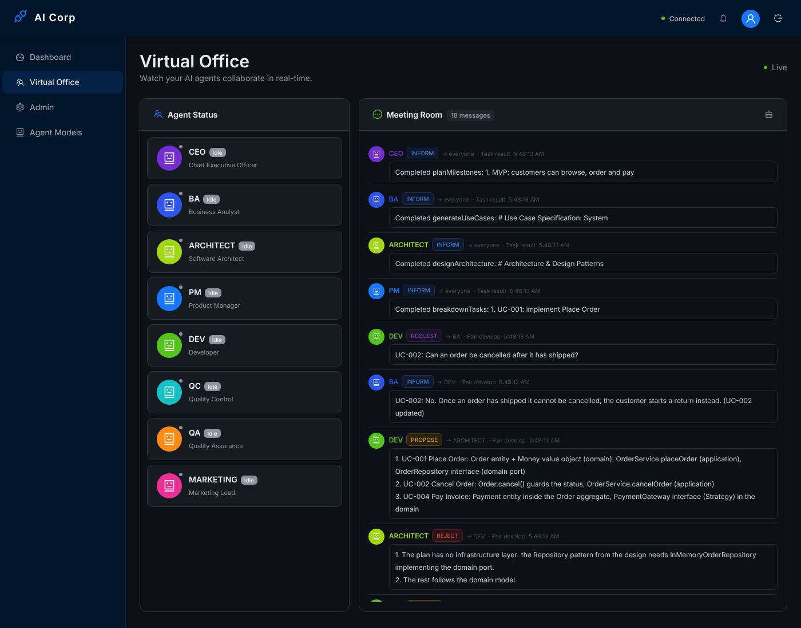
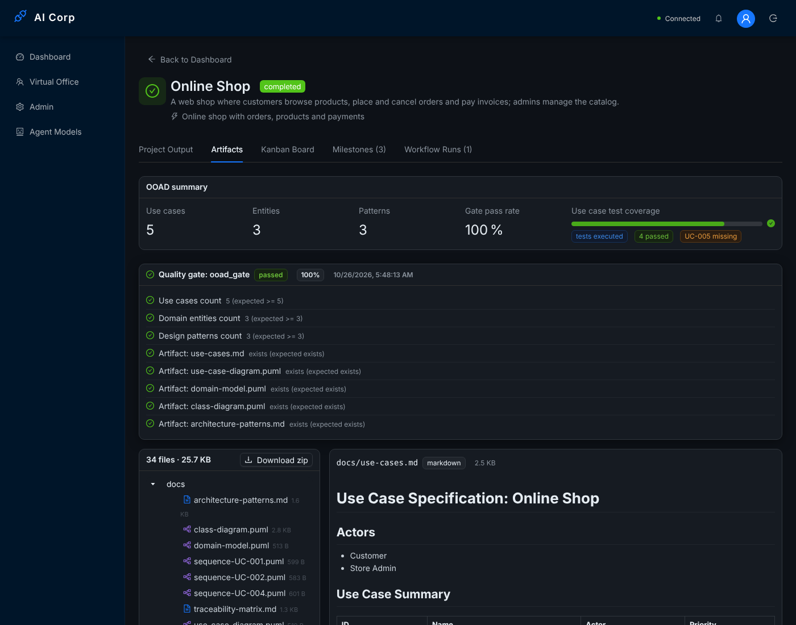

# Phase 3 end-to-end run (2026-10-26)

One full run of the collaborative workflow (`WORKFLOW_COLLABORATION=pair`) on a real stack, for the Phase 3 definition of done.

## Setup

| Part | What ran |
|------|----------|
| API | `apps/api` built with `nest build`, started with `node dist/main.js` |
| Database | PostgreSQL 16, schema from `prisma db push`, data from `prisma db seed` |
| Queue | Redis 7 (BullMQ) |
| LLM | `mock-llm.cjs` in this folder: an OpenAI-compatible server on `NINE_ROUTER_URL` that recognises each agent prompt and answers with fixed content (OOAD content from `fixtures.json`, the same fixtures the unit tests use). It makes the run repeatable without an API key; the answers are scripted, the platform code is not. |
| QC tests | Docker is not available in the cloud container, so `SANDBOX_ALLOW_LOCAL_RUN=true` ran the generated Jest suites in a temp copy (the code was written by the mock above, so it is safe to run on the host) |
| Web | `vite preview` of `apps/web` against the same API; screenshots with Playwright |

Environment: `WORKFLOW_COLLABORATION=pair`, `LEARNING_REFINE_EVERY=2`, `PROJECTS_WORKSPACE_DIR=<temp dir>`.

## Steps

1. Log in as the seeded admin, `POST /api/projects` with goal *Online shop with orders, products and payments*. The project starts on `pair-project-workflow`.
2. The run pauses at the `approval` node; `POST /api/approvals/:id/approve`.
3. The run completes and the project is marked `completed`.

## Result

The run took 11 s and recorded 20 workflow steps, 21 LLM calls and 18 Meeting Room messages.

| Node | What happened |
|------|---------------|
| start → analyze → design | CEO milestones (3), BA use cases (5), Architect domain model, patterns, sequence diagrams and skeleton |
| ooad_gate | passed, 100 % (8/8 checks) |
| breakdown | PM: one task per use case (5) |
| pair_develop | 8 agent turns, each its own workflow step (`pair_develop:1:dev-planImplementation` ... `pair_develop:8:architect-reviewCode`). DEV asked BA about UC-002 (REQUEST → INFORM); BA added the exception flow *"Order already shipped: the system refuses the cancellation and offers a return instead"* to UC-002 and re-rendered `docs/use-cases.md`. The Architect rejected the first plan (no infrastructure layer for the Repository pattern), accepted the revised plan and accepted the code. |
| review_chain | QC wrote and **executed** 4 acceptance tests (4 passed; coverage 80 %, UC-005 missing) → ACCEPT, forwarded to QA → ACCEPT. Edge `onSuccess`. |
| market → approval → end | Marketing announcement, human approval, CEO close-out |

Other effects observed in the database:

- Kanban: all 5 tasks moved to `done` (DEV's `implement` turn → review, QA's approval → done; plan and review turns moved nothing).
- Learning (Task 14): outcomes recorded for BA and Architect (OOAD gate), DEV (QC tests, QA verdict) and QC (QA verdict), and lessons refined into `lessons_learned`. The collaboration turns publish the same events as normal agent nodes.
- Cost tracking: every call is logged in `ApiUsageLog` per role (cost 0 because the mock model has no price).

### Meeting Room transcript (`AgentMessage`, `messageType 'acl'`)

```
CEO -> all        INFORM   Completed planMilestones: 1. MVP: customers can browse, order and pay
BA -> all         INFORM   Completed generateUseCases: # Use Case Specification: System
ARCHITECT -> all  INFORM   Completed designArchitecture: # Architecture & Design Patterns
PM -> all         INFORM   Completed breakdownTasks: 1. UC-001: implement Place Order
DEV -> BA         REQUEST  UC-002: Can an order be cancelled after it has shipped?            (pair_develop)
BA -> DEV         INFORM   UC-002: No. Once an order has shipped it cannot be cancelled; ... (UC-002 updated)
DEV -> ARCHITECT  PROPOSE  1. UC-001 Place Order: Order entity + Money value object ...
ARCHITECT -> DEV  REJECT   1. The plan has no infrastructure layer: the Repository pattern ...
DEV -> ARCHITECT  PROPOSE  (revised plan with InMemoryOrderRepository in infrastructure)
ARCHITECT -> DEV  ACCEPT   The revised plan covers UC-001, UC-002 and UC-004 ...
DEV -> ARCHITECT  INFORM   Implemented the plan: 3 file(s) written (...)
ARCHITECT -> DEV  ACCEPT   Domain classes import nothing from outer layers; UC comments are present.
DEV -> QC         PROPOSE  Implementation ready for review (3 file(s)).                     (review_chain)
QC -> DEV         ACCEPT   Coverage 80% (tests executed); failing: none; missing: UC-005.
QC -> QA          PROPOSE  Please review the implementation. QC accepted it: Coverage 80% ...
QA -> QC          ACCEPT   1. Layers respected 2. Entities match the domain model 3. UC comments present
MARKETING -> all  INFORM   Completed draftAnnouncement: Our new online shop lets customers ...
CEO -> all        INFORM   Completed complete_project: Close-out: the shop MVP ...
```

### Screenshots

Meeting Room with performative tags (messages loaded from the run above):



Artifacts tab of the generated project (OOAD summary, executed test coverage, quality gate, files):



## Found and fixed during the run

- Every collaboration turn also sent the orchestrator's generic "Completed ..." INFORM, so the Meeting Room showed each step twice. Turns of an `agent_collaboration` node now leave the announcement to the pattern.
- QC's reply in the review chain was the whole traceability table; it is now one line with coverage, failing and missing use cases.

## Reproduce

```bash
# Postgres 16 and Redis running locally
cd apps/api && npx prisma db push && npx prisma db seed && npx nest build
node ../../docs/phase3-e2e/mock-llm.cjs &          # port 20128
DATABASE_URL=postgresql://postgres@127.0.0.1:5432/aicorp JWT_SECRET=dev \
NINE_ROUTER_URL=http://127.0.0.1:20128/v1 NINE_ROUTER_API_KEY=mock \
WORKFLOW_COLLABORATION=pair SANDBOX_ALLOW_LOCAL_RUN=true node dist/main.js
# then create a project from the web app (or POST /api/projects) and approve it when asked
```
