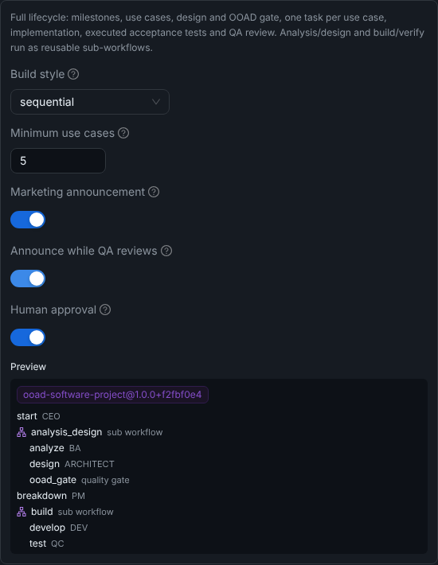
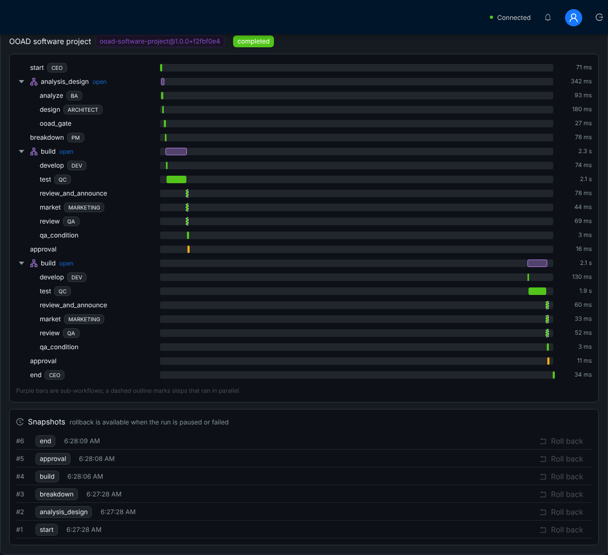
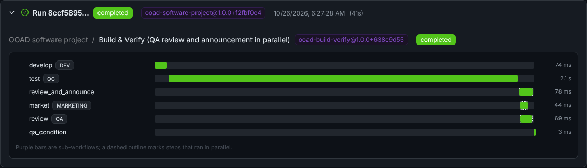

# Phase 4 end-to-end run (2026-10-26)

Runs of the Phase 4 workflow engine on a real stack: projects created from templates, sub-workflows, a parallel step, rollback after an approval, a failure recovered by rollback, and a server restart in between.

## Setup

| Part | What ran |
|------|----------|
| API | `apps/api` built with `nest build`, started with `node dist/main.js` |
| Database | PostgreSQL 16, schema from `prisma db push` (adds `WorkflowSnapshot`, `WorkflowDefinitionVersion` and the run's version/parent columns), data from `prisma db seed` |
| Queue | Redis 7, so nodes run through BullMQ (the path where defect B1 left failed runs stuck) |
| LLM | `docs/phase3-e2e/mock-llm.cjs`: scripted OpenAI-compatible answers, so the run is repeatable without an API key |
| QC tests | `SANDBOX_ALLOW_LOCAL_RUN=true` (no Docker in the container) |
| Driver | `e2e.mjs` in this folder (modes `template`, `rollback`, `failing`, `recover`) |
| Web | `vite preview` against the same API; screenshots with Playwright |

## 1. Project from the *OOAD software project* template

`POST /api/projects` with `templateId: "ooad-software-project"` and `templateParams: { parallelMarketing: true }`. The run is pinned to `ooad-software-project@1.0.0+f2fbf0e4` and paused at the approval node after 3.2 s:

```
[ooad-software-project@1.0.0+f2fbf0e4 paused] start, analysis_design, breakdown, build, approval:pending
  [ooad-analysis-design@1.0.0+8015ac27 completed] analyze, design, ooad_gate
  [ooad-build-verify@1.0.0+638c9d55 completed] develop, test, review_and_announce, market, review, qa_condition
parallel layers [["review","market"]]: review 06:27:30.953-31.026, market 06:27:30.953-31.001 (same start)
snapshots #1 start, #2 analysis_design, #3 breakdown, #4 build, #5 approval
```

The template form with its parameters and the preview of what will run:



## 2. Server restart, then rollback after the approval request

The API was stopped and started again. At startup it reloaded the three stored definitions from `WorkflowDefinitionVersion` (sub-workflows first), so the paused run still found `ooad-software-project@1.0.0+f2fbf0e4`.

Then, from the paused run:

| Call | Result |
|------|--------|
| `POST /workflows/runs/:id/rollback { snapshotId: <#4 build> }` | "Rolled back to snapshot #4; the run is paused at node build". 1 pending approval cancelled; snapshots now #1–#3 |
| `POST …/resume`, then `POST …/rollback` while running | 400 "Cannot roll back … with status running: pause it first" |
| wait | paused at `approval` again; the run now has two `build` child runs (the first one and the re-run) |
| `POST /approvals/:id/approve` | run `completed`, project `completed`; the project lists 1 run (child runs are only in the run tree) |

The run in the *Workflow Runs* tab: version tag, Gantt timeline with both sub-workflows expanded (the history keeps the rolled-back `build` and `approval` steps), the parallel branches outlined, and the snapshots with *Roll back*:



Opening the `build` sub-workflow (breadcrumb back to the parent):



## 3. Failure, then recovery by rollback

The mock LLM was stopped and a project was created from the *REST API backend* template (`database: MongoDB`). The CEO node failed 4 times ("Connection error.", 3 retries with backoff), and after 12.9 s the run was **`failed`** at `start`. Before Phase 4 this run would have stayed `running` forever (defect B1).

The mock LLM was started again, then `POST …/rollback { steps: 1 }` → "Rolled back to snapshot #1; the run is paused at node start" → `POST …/resume`:

```
final completed | steps start:failed ×4, start:completed, analysis_design, breakdown, build, end
children ooad-analysis-design@1.0.0+dd35d13b:completed, ooad-build-verify@1.0.0+5d9c7296:completed
```

The REST API template's `ooad-analysis-design` has another version than the full project's (the Architect node carries the MongoDB constraint); its `ooad-build-verify` differs from run 1's only because run 1 used the parallel option.

## Reproduce

```bash
# Postgres 16 and Redis running locally
cd apps/api && npx prisma db push && npx prisma db seed && npx nest build
node ../../docs/phase3-e2e/mock-llm.cjs &          # port 20128
DATABASE_URL=postgresql://postgres@127.0.0.1:5432/aicorp JWT_SECRET=dev \
NINE_ROUTER_URL=http://127.0.0.1:20128/v1 NINE_ROUTER_API_KEY=mock \
SANDBOX_ALLOW_LOCAL_RUN=true node dist/main.js &
node ../../docs/phase4-e2e/e2e.mjs template                       # prints projectId and runId
node ../../docs/phase4-e2e/e2e.mjs rollback <projectId> <runId> build
# stop the mock LLM, then
node ../../docs/phase4-e2e/e2e.mjs failing                        # prints projectId and runId
# start the mock LLM again, then
node ../../docs/phase4-e2e/e2e.mjs recover <projectId> <runId>
```

## Known limits

- Workspace files are not part of a snapshot; the agents that run again rewrite theirs.
- A `human_approval` node can't be inside a sub-workflow (the registry rejects it).
- The approval node's step keeps the status `pending` after the approval is answered (behaviour from before Phase 4).
