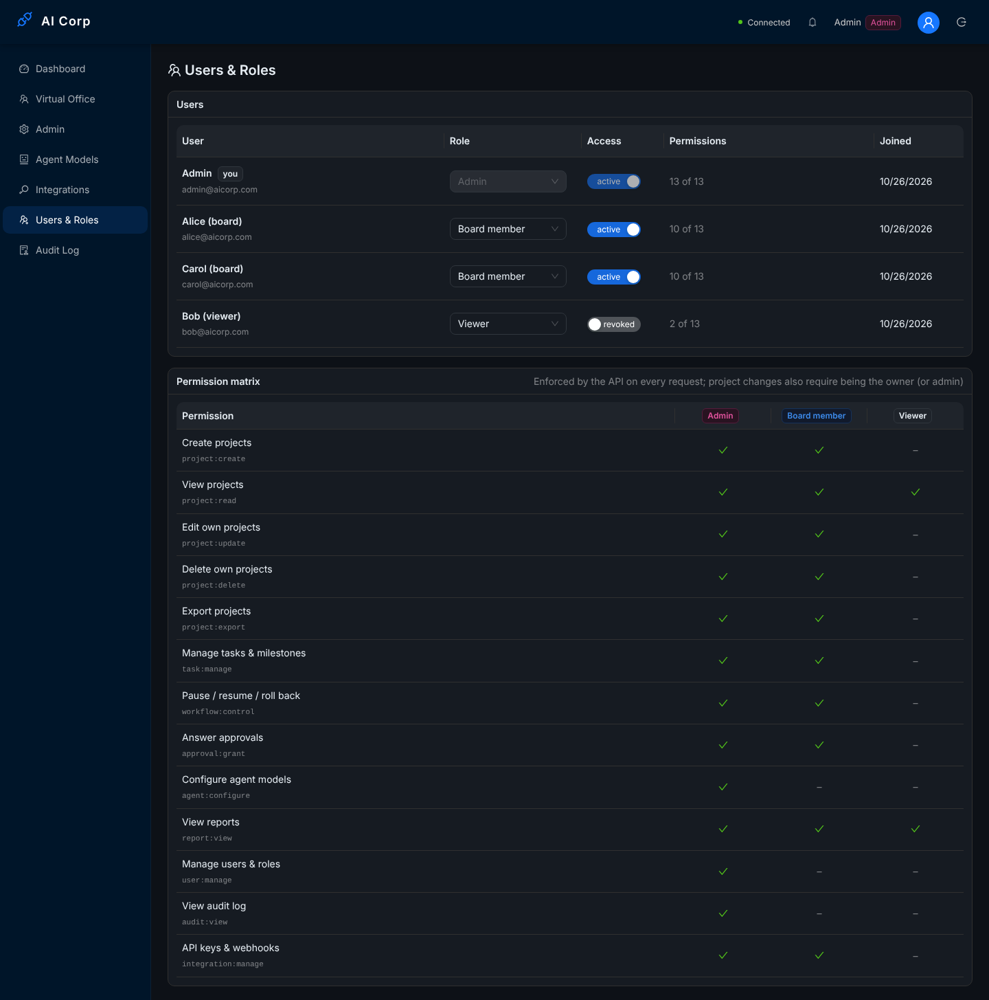
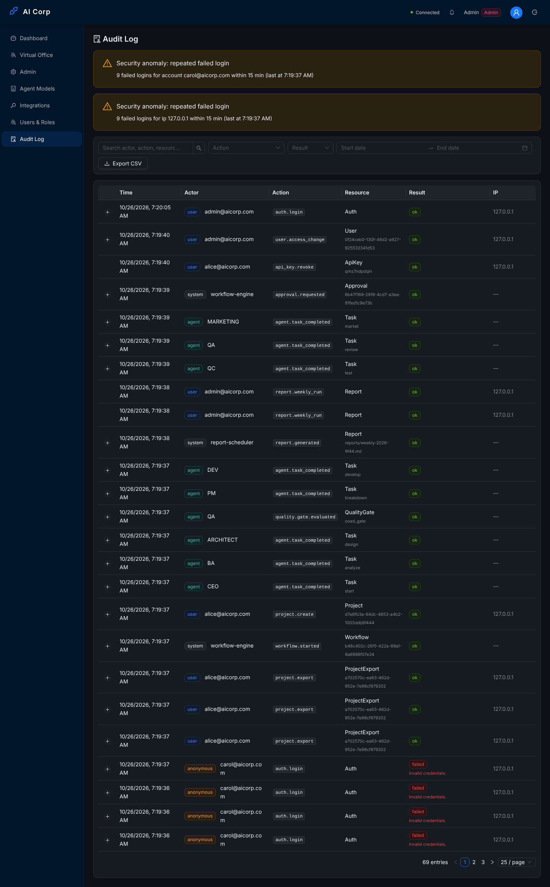
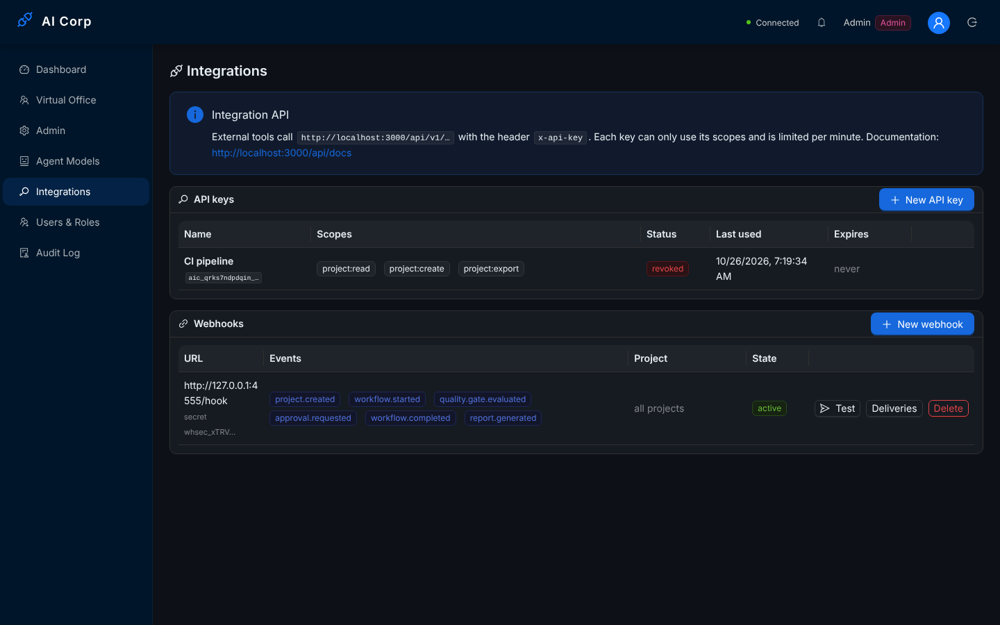
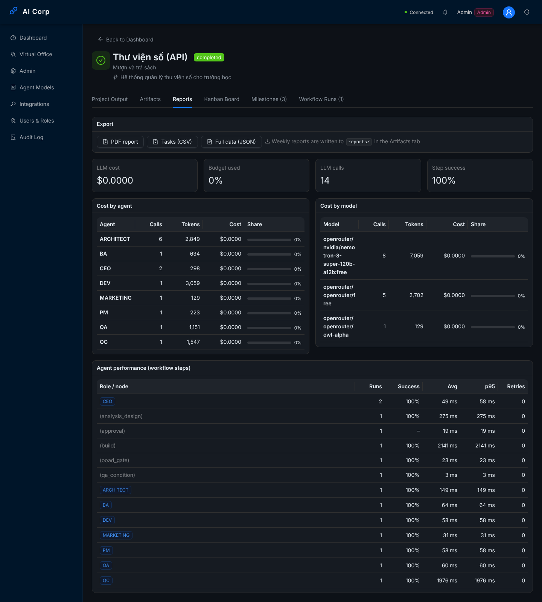

# Phase 5 end-to-end run (2026-10-26)

A run of the Phase 5 features on a real stack: roles and permissions, the audit log, API keys, webhooks, rate limits, exports and reports. The driver is `e2e.mjs` in this folder; it prints one line per check and ends with **44/44 checks passed**.

## Setup

| Part | What ran |
|------|----------|
| API | `apps/api` built with `nest build`, started with `node dist/main.js`, `API_RATE_LIMIT_PER_MINUTE=20` (so the limit is reached quickly) and `WEBHOOK_ALLOW_PRIVATE_NETWORKS=true` (the webhook receiver is on 127.0.0.1) |
| Database | PostgreSQL 16, new empty database, schema from `prisma db push` (adds `AuditLog`, `ApiKey`, `Webhook`, `WebhookDelivery`, `User.isActive`), data from `prisma db seed` |
| Queue | Redis 7 (BullMQ) |
| LLM | `docs/phase3-e2e/mock-llm.cjs` (scripted answers, free, so every cost is $0) |
| Webhook receiver | started by `e2e.mjs` on `127.0.0.1:4555`; it checks every signature and writes what it received to `out/webhooks-received.json` |
| Web | Vite against the same API; screenshots with Playwright, signed in as the seeded admin |

```
node docs/phase5-e2e/e2e.mjs            # writes to docs/phase5-e2e/out
```

## What was checked

**Roles and permissions (Task 20).** The admin turns Bob into a *viewer*; Bob's existing token follows the change at once. A viewer can list projects and read reports but cannot create projects, approve or read the audit log. A board member cannot manage users. The last active admin cannot be demoted. Alice owns her project: Carol (another board member) gets 403 when she tries to edit it or answer its approval. Deactivating Bob makes his next request fail.

**Integration API (Task 22).** Alice creates an API key with `project:read`, `project:create` and `project:export`. A viewer cannot create a key with scopes beyond the viewer role. The key:

| Check | Result |
|-------|--------|
| used on `/api/projects` (outside `/api/v1`) | 401 |
| used for a scope it does not have | 403 |
| wrong secret | 401 |
| `POST /api/v1/projects` | project created; the answer links to `/api/v1/projects/:id/status` |
| `GET /api/v1/projects/:id/status` while the run waits | `paused at approval, 5 steps, coverage 80` |
| `GET /api/v1/projects/:id/export` | 200 |
| more than 20 requests in one minute | 429 with `Retry-After` |
| after revocation | 401 |

Logins are limited too (10 per minute per IP and email): after 9 wrong passwords for `carol@aicorp.com`, the next attempt gets 429. `GET /api/docs-json` documents 13 paths: the `/api/v1` API and the key and webhook management.

**Webhooks (Task 22).** Alice registers a webhook for six events. The receiver got 11 deliveries, all with a valid `X-AICorp-Signature` (HMAC-SHA256 over `"<timestamp>.<body>"`), and all 11 are in `GET /api/integrations/webhooks/:id/deliveries`:

```
webhook.test, project.created, workflow.started, quality.gate.evaluated, approval.requested, workflow.completed, report.generated
```

`approval.requested` could only be delivered after the fix to `HumanApprovalStrategy` (defect C1 in the plan). See `out/webhooks-received.json`.

**Exports and reports (Task 23).**

| Output | File |
|--------|------|
| PDF report (Vietnamese text rendered with a Unicode font) | `out/thu-vien-so-api-2026-10-26.pdf` |
| Tasks as CSV (UTF-8 BOM) | `out/thu-vien-so-api-2026-10-26-tasks.csv` |
| Full data as JSON | `out/thu-vien-so-api-2026-10-26.json` |
| Weekly report written into a running project's workspace | `out/weekly-2026-W44.md` |

The viewer reads the cost report (`$0 over 14 calls, 8 agents`). The performance report lists each role and node with its success rate (`CEO 2x 100%`, `(analysis_design) 1x 100%`, …). Running the weekly report twice in the same week writes the file once.

**Audit log (Task 21).** The log holds user, agent and system actions from the run:

```
access.denied, agent.task_completed, api_key.create, approval.approve, approval.requested, auth.login,
auth.register, project.create, project.export, project.update, quality.gate.evaluated, report.generated,
report.weekly_run, user.role_change, webhook.create, workflow.completed, workflow.started
```

Alice's budget change is stored with its diff `[{"field":"budget","from":5,"to":12}]`. The 9 failed logins show up as two anomalies (per account and per IP). The CSV export filtered on projects is `out/audit-projects.csv`.

## Screenshots

*Users & Roles*: users with role and access switch (Bob is deactivated), and the permission matrix from `RolePolicy`:



*Audit Log*: the two anomaly warnings, filters, CSV export and entries from users, agents and the system:



*Integrations*: the revoked key and the webhook with its events, *Test* and *Deliveries*:



The project's *Reports* tab: export buttons, cost by agent and by model, and agent performance from the workflow steps:


