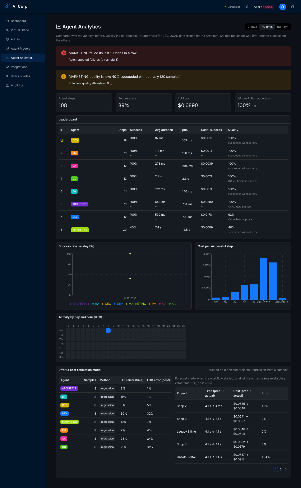
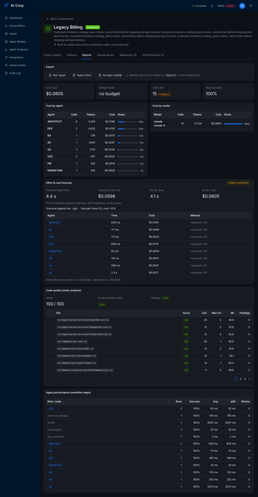

# Phase 6 end-to-end run (2026-10-26)

Agent analytics, the effort and cost model, code quality and the anomaly path, run on a real stack: 8 projects through the full OOAD workflow, then 3 runs during a Marketing model outage. The load test on the same stack is in [`load-test.md`](load-test.md).

## Setup

| Part | What ran |
|------|----------|
| API | `apps/api` built with `nest build`, started with `node dist/main.js` |
| Database | PostgreSQL 16, schema from `prisma db push` (adds `ProjectEstimate` and the `WorkflowStep` indexes), data from `prisma db seed` |
| Queue | Redis 7 (BullMQ) |
| LLM | `mock-llm.cjs` in this folder: the Phase 3 scripted answers, plus latency that grows with the prompt and a priced model name (so durations and costs vary with the project's size), messy first code for *Legacy…* and *Unsafe…* projects, and `POST /control {"failMarketing": true}` to make Marketing calls fail |
| QC tests | `SANDBOX_ALLOW_LOCAL_RUN=true` (no Docker in the container) |
| Webhooks | A receiver on `127.0.0.1:4556` subscribed to `agent.anomaly` and `workflow.failed` (`WEBHOOK_ALLOW_PRIVATE_NETWORKS=true`) |
| Driver | `e2e.mjs` in this folder; its log is [`e2e-output.txt`](e2e-output.txt), the API answers are in `out/` |
| Web | Vite against the same API; screenshots with Playwright, signed in as the seeded admin |

All 8 projects use the *OOAD software project* template with `humanApproval: false`; their descriptions grow from 1 to 12 sentences, so the model has something to learn.

## Result: 21/21 checks

### Estimation (Task 25)

- After 8 finished projects every role uses **regression** (6 samples are needed). Leave-one-out error of agent time: Architect 3%, CEO 5%, BA 11%, DEV 30% (`out/estimation-model.json`).
- Each project from the 2nd on stored a forecast when its workflow started and another one when the PM had planned (`start`, `planned`); the PM's 5 tasks of the last project carry `estimatedCost` $0.01; the first project, with no history, has none.
- Mean absolute error of the start forecast over 7 projects: time 21%, cost 20%. Most of it is *Unsafe Portal* (+84% cost): QA rejected its code and DEV ran twice, which no forecast made at the start can know. The other projects are within 0–10%.

### Code quality (Task 26)

- *Legacy Billing*: DEV's first `Order.ts` imported the infrastructure layer, held a hard-coded key, called `eval` and packed its rules into one long `cancel` method. Predicted QA verdict *fail* (score 77, layer violation), so DEV refined it once; the rewrite scored 100 and was kept. The report (`out/code-quality-legacy.md`) starts with "Score before refinement: 77. Refined: src/domain/entities/Order.ts."
- *Unsafe Portal*: the refinement did not help (same score), so the original was kept, QA saw `eval(` and the analysis, answered **FAIL**, and DEV ran again with clean code (score 100).
- QA prediction accuracy over 9 reviews: 8 predicted pass and passed, 1 predicted fail and failed (100%).

### Analytics and anomalies (Task 24)

- 8 roles ranked; DEV's quality is its QA approval rate, 89% (8 of 9 reviews); no anomaly while everything works.
- With the Marketing model down, 3 runs failed after their retries. The monitor then raised *MARKETING failed its last 10 steps in a row* (repeated failures) and *quality is low* (40% first-attempt success). Both reached the webhook receiver and the audit log, and the 3 `workflow.failed` events were delivered.

The *Agent Analytics* page after the run (anomalies, leaderboard, charts, heatmap, the estimation model and its accuracy):



*Legacy Billing* → *Reports*: the forecast against the outcome and the code quality of the refined code:



## Reproduce

```bash
# Postgres 16 and Redis running locally
cd apps/api && npx prisma db push && npx prisma db seed && npx nest build
node ../../docs/phase6-e2e/mock-llm.cjs &          # port 20128
DATABASE_URL=postgresql://... JWT_SECRET=dev \
NINE_ROUTER_URL=http://127.0.0.1:20128/v1 NINE_ROUTER_API_KEY=mock \
SANDBOX_ALLOW_LOCAL_RUN=true WEBHOOK_ALLOW_PRIVATE_NETWORKS=true node dist/main.js &
node ../../docs/phase6-e2e/e2e.mjs                 # about 3 minutes; exit 1 if a check fails
```

Start from an empty database: the checks count projects and anomalies.

## Known limits

- The model has two features and learns from finished projects only; rework (a QA rejection) is not predictable at the start, which is why each forecast is compared with the outcome instead of being trusted.
- The analysis covers TypeScript/JavaScript under `src/`; the generated projects are TypeScript by design.
- Refinement is one round by design (bounded LLM cost); after it, QA's loop back to DEV is the second chance.
