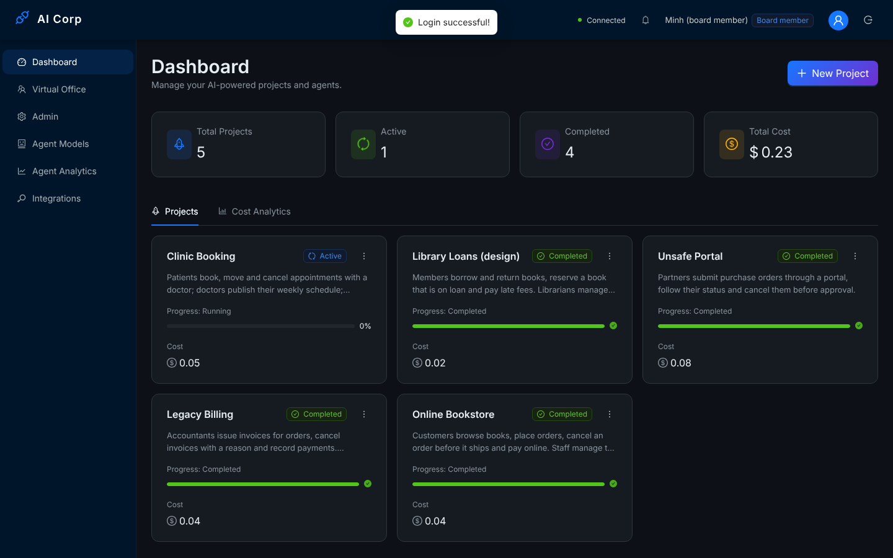
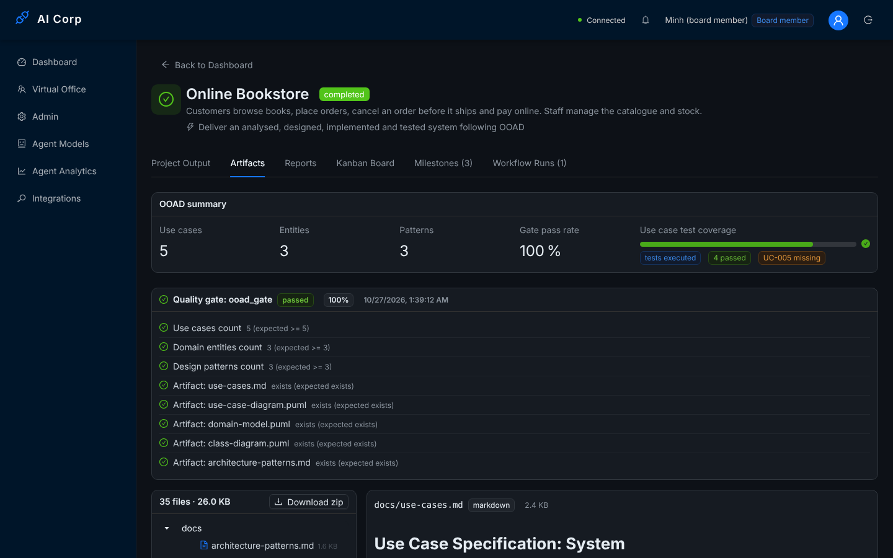
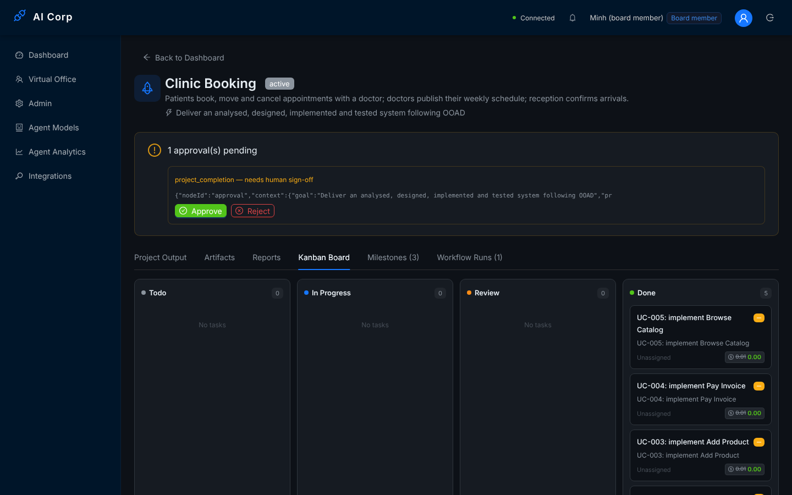
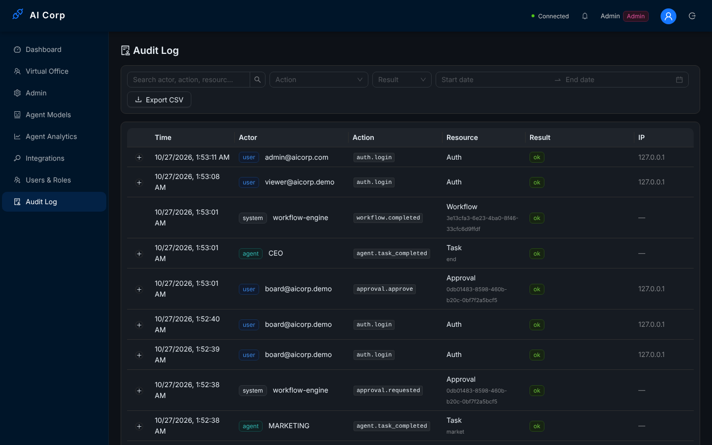

# Phase 7 end-to-end run (2026-10-27)

The production build behind nginx, started the way `docker-compose.prod.yml` starts it, with the demo data from `scripts/demo/seed-demo.mjs`. This run checks what unit tests cannot see: migrations on an empty database, the production config check, health under a database outage, the same-origin proxy for the API and Socket.IO, and the demo's role and approval story through the paths the web app really uses.

## Setup

| Part | What ran |
|------|----------|
| Database | PostgreSQL 16 with pgvector, **empty**; schema from `prisma migrate deploy` (no `db push`), then `npm run db:check` (`prisma migrate diff --exit-code` against the model): no drift |
| Queue | Redis 7 (BullMQ) |
| API | `nest build`, `NODE_ENV=production`, `ENABLE_SWAGGER=false`, `CORS_ORIGIN=http://localhost:8080`, a 64-character `JWT_SECRET`, compiled seed with `SEED_ADMIN_PASSWORD` |
| Web | `vite build` with `VITE_API_URL=/api`, `VITE_WS_URL=/`, `VITE_PLANTUML_SERVER=/plantuml`, served by nginx with `apps/web/nginx.conf` on port 8080 (`api` and `plantuml` resolved to localhost) |
| LLM | `scripts/demo/demo-llm.cjs` (the scripted answers of `docs/phase6-e2e/mock-llm.cjs`, 400 ms delay, reset by the seed) |
| QC tests | `SANDBOX_ALLOW_LOCAL_RUN=true` (no Docker in the container) |
| Demo data | `seed-demo.mjs`: board and viewer accounts, 5 projects, about 25 s |
| Driver | `e2e.mjs` in this folder, against `http://localhost:8080`; answers in `out/` |

Docker is not available in the build container, so the images themselves were not built here; every step of the entrypoint (migrate, seed, start) ran the same commands on the host.

## Before the run: configuration and health

- Production start with `JWT_SECRET` and `CORS_ORIGIN` missing and `NINE_ROUTER_API_KEY=CHANGE_ME`: the API exits with code 1 and lists all three errors.
- `GET /api/health` reports database, Redis and LLM gateway *healthy*. With PostgreSQL stopped it answers **503** (status *unhealthy*) while `GET /api/health/live` stays 200; after PostgreSQL restarts it is 200 again.

## Result: 21/21 checks

| Area | Checks |
|------|--------|
| Production stack | readiness through nginx; liveness; Swagger off; CORS only for `CORS_ORIGIN`; SPA routes served by nginx |
| Realtime | Socket.IO through nginx accepts the login token; a forged token is disconnected |
| Demo projects | 5 present, 4 completed; *Online Bookstore* has its OOAD artifacts, code and tests, passed the OOAD gate and ran its acceptance tests; *Legacy Billing*: DEV refined the code before QA; *Unsafe Portal*: QA sent the code back to DEV once |
| Roles and approval | the viewer cannot create a project; *Clinic Booking* waits for the board member; the viewer cannot answer the approval over REST **or over the WebSocket**; after the board member approves, the CEO closes the project |
| Reports and audit | PDF export; agent analytics cover the 8 roles; the audit log records logins, project creation and the approval |

The WebSocket check was added in this run: before the fix, a viewer's `human:approval_response` message was accepted, closed *Clinic Booking* and left no audit entry (defect E2 in `Implementation_plan.md`).

Screenshots, signed in as the board member through nginx:

| | |
|---|---|
|  |  |
|  |  |

The recorded walkthrough of the demo (`docs/demo/record-walkthrough.cjs`, 11 scenes, approval answered in the UI) is the fallback video for the defence.

## Reproduce

```bash
# PostgreSQL (pgvector) and Redis running, an empty database in DATABASE_URL, a scratch one in SHADOW_DATABASE_URL
cd apps/api && npx prisma migrate deploy && npm run db:check && npx nest build && npm run build:seed
SEED_ADMIN_PASSWORD='<12+ characters>' NODE_ENV=production npm run db:seed:compiled
node ../../scripts/demo/demo-llm.cjs &
NODE_ENV=production JWT_SECRET=<64 hex> CORS_ORIGIN=http://localhost:8080 ENABLE_SWAGGER=false \
NINE_ROUTER_URL=http://127.0.0.1:20128/v1 NINE_ROUTER_API_KEY=demo SANDBOX_ALLOW_LOCAL_RUN=true node dist/main.js &
cd ../web && VITE_API_URL=/api VITE_WS_URL=/ VITE_PLANTUML_SERVER=/plantuml npx vite build
# serve apps/web/dist with apps/web/nginx.conf on :8080 (api → 127.0.0.1:3000)
DEMO_ADMIN_PASSWORD='<same>' node ../../scripts/demo/seed-demo.mjs http://localhost:8080/api
node ../../docs/phase7-e2e/e2e.mjs http://localhost:8080
```

With Docker the whole stack is `docker compose -f docker-compose.prod.yml --env-file .env.production --profile demo up -d --build`, then the last two commands.
