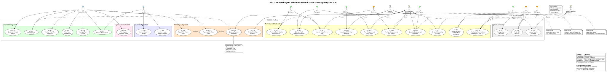
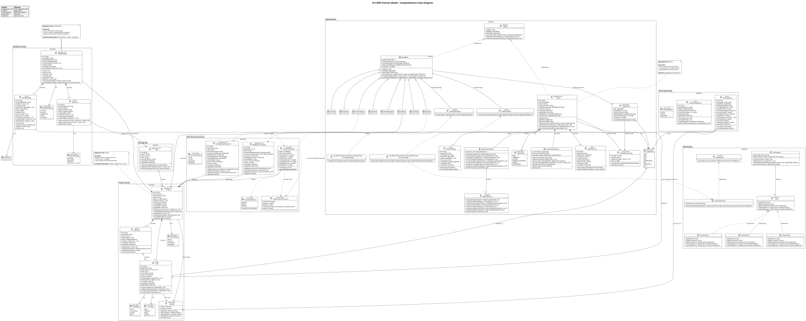

# Phân tích yêu cầu

Chương này xác định ai dùng nền tảng, nền tảng phải làm gì và phải đạt chất lượng nào. Đặc tả đầy đủ 31 use case nằm trong `docs/requirements/use-cases.md`; ma trận truy vết yêu cầu → use case → thiết kế → mã → kiểm thử nằm trong `docs/requirements/traceability-matrix.md`. Chương này tóm tắt và phân tích các quyết định chính.

## Tác nhân và vai trò tác tử

Nền tảng có hai loại tác nhân: con người và tác tử AI.

**Tác nhân con người.** Phân quyền theo vai trò (RBAC) [47] với ba vai trò:

| Vai trò | Quyền chính |
|---------|-------------|
| Quản trị viên (admin) | Quản lý người dùng và vai trò, cấu hình mô hình LLM cho tác tử, xem nhật ký kiểm toán, quản lý khoá API và webhook của mọi người, theo dõi sức khoẻ hệ thống |
| Thành viên hội đồng quản trị (board member) | Tạo và sở hữu dự án, duyệt hoặc từ chối các bước cần con người, xem chi phí, báo cáo và phân tích, xuất dữ liệu, quản lý khoá API và webhook của mình |
| Người xem (viewer) | Chỉ đọc: xem dự án, báo cáo và tài liệu sinh ra |

Ngoài vai trò, mỗi dự án có một **chủ sở hữu**: thành viên hội đồng chỉ duyệt được các phê duyệt được giao cho mình và chỉ sửa được dự án của mình. Tác tử AI không phải người dùng đăng nhập; mọi hành động của chúng được ghi vào nhật ký kiểm toán với loại tác nhân `agent`.

**Tác tử AI.** Nền tảng ban đầu có năm tác tử. Việc rà soát vai trò dẫn đến ba thay đổi:

1. **Thêm BA và Architect**, vì một quy trình OOAD cần người viết use case và người dựng mô hình miền trước khi lập kế hoạch.
2. **Bỏ DevOps.** Sản phẩm của nền tảng là một dự án đã được phân tích, thiết kế, hiện thực và kiểm thử, không phải một bản triển khai đang chạy. Tác tử DevOps chưa từng nằm trong quy trình, chỉ sinh văn bản không ai dùng, và sandbox không có mạng hay ổ lưu trữ để triển khai. Giữ lại nó sẽ thêm một vai trò không có đầu ra kiểm chứng được và kéo phạm vi sang CI/CD.
3. **Tách QA và QC** theo định nghĩa của ISO 9000 [53]. Tác tử QA cũ trộn cả hai việc và thực tế không làm tốt việc nào.

| Tác tử | Trách nhiệm | Đầu ra kiểm chứng được |
|--------|-------------|------------------------|
| CEO | Định hướng, chia mốc, đóng dự án | Mốc (milestone), báo cáo đóng dự án |
| BA | Phân tích yêu cầu | `docs/use-cases.md` (use case có ID, tác nhân, luồng chính, luồng thay thế, tiêu chí chấp nhận) |
| Architect | Thiết kế | Mô hình miền, sơ đồ use case, lớp, tuần tự (PlantUML), `docs/architecture-patterns.md`, khung mã phân lớp |
| PM | Lập kế hoạch | Một công việc cho mỗi use case đã duyệt, có ước lượng chi phí |
| DEV | Hiện thực | Mã TypeScript theo bốn tầng, chú thích `UC-xxx` |
| QC (sản phẩm) | Kiểm soát chất lượng | `tests/UC-xxx.spec.ts`, kết quả chạy Jest, `docs/traceability-matrix.md`, độ bao phủ use case |
| QA (quy trình) | Đảm bảo chất lượng | Cổng OOAD sau thiết kế, rà soát mã so với thiết kế, phán quyết PASS/FAIL điều khiển vòng lặp về DEV |
| Marketing | Truyền thông | Thông báo sản phẩm |

## Yêu cầu chức năng

Các yêu cầu chức năng được nhóm thành bốn nhóm lớn (mã trong ngoặc là nhóm trong ma trận truy vết):

**Hệ thống tác tử (FR1).** Tám vai trò tác tử như trên; tác tử học từ kết quả trước qua bộ nhớ được tinh luyện; tác tử cộng tác theo các mẫu lập trình cặp và chuỗi rà soát; tác tử giao việc con cho nhau qua bus thông điệp.

**Bộ máy quy trình (FR2).** Quy trình con và lồng ghép quy trình; phiên bản bất biến và khôi phục về ảnh chụp; thực thi song song có giải quyết phụ thuộc; mẫu quy trình có tham số kiểu.

**Tính năng doanh nghiệp (FR3).** RBAC với quyền chi tiết và quyền sở hữu dự án; nhật ký kiểm toán đầy đủ; API tích hợp cho công cụ bên ngoài (khoá API, webhook); xuất dữ liệu và báo cáo.

**Tính năng AI/ML (FR4).** Phân tích hiệu năng và quá trình học của tác tử; mô hình ước lượng dựa trên dữ liệu lịch sử; dự đoán chất lượng mã bằng phân tích tĩnh; gợi ý tối ưu dựa trên bất thường.

Ma trận truy vết có 120 yêu cầu chức năng và phi chức năng: 111 ở trạng thái *Implemented*, 1 ở *Partial* và 8 ở *Planned* (các mục chưa làm được ghi rõ là chưa làm thay vì bị xoá); mỗi yêu cầu đã hiện thực trỏ đến tệp mã và tệp kiểm thử.

## Yêu cầu phi chức năng

| Nhóm | Yêu cầu | Cách kiểm chứng |
|------|---------|----------------|
| Kiến trúc | Tuân thủ SOLID; mẫu thiết kế được áp dụng có lý do; tách tầng miền, ứng dụng, hạ tầng; tiêm phụ thuộc xuyên suốt | Rà soát thiết kế (chương 4), luật phân lớp được kiểm tra tự động trên mã sinh ra |
| Kiểm thử | Tầng miền ≥ 90% hàm, dòng, lệnh và ≥ 85% nhánh; toàn API có ngưỡng sàn; kiểm thử đầu-cuối cho các hành trình chính | Ngưỡng `coverageThreshold` của Jest làm hỏng lệnh `test:cov` nếu không đạt; các lần chạy đầu-cuối có lưu vết |
| Hiệu năng | Mỗi nút quy trình ≤ 2 s (không tính độ trễ LLM); các đọc trên bảng điều khiển trong ngân sách p50/p95/p99 với 20 người dùng đồng thời, lỗi ≤ 1% | Đo bước quy trình (mục 6.4), kiểm thử tải có ngân sách (mục 6.5) |
| Bảo mật | Băm mật khẩu bcrypt; JWT có hạn; khoá API chỉ mang phạm vi mà vai trò chủ sở hữu cho phép; nhật ký kiểm toán không lưu bí mật; webhook ký HMAC và chặn địa chỉ mạng nội bộ; sandbox cách ly; cấu hình production sai thì không khởi động | Kiểm thử đơn vị và đầu-cuối (mục 6.3) |
| Tin cậy | Thử lại có giãn cách mũ; khôi phục quy trình khi khởi động lại; kiểm tra sức khoẻ cho cân bằng tải | Kiểm thử bộ máy quy trình, kiểm thử sức khoẻ |
| Tài liệu | Đủ sơ đồ use case, lớp, tuần tự, hoạt động, máy trạng thái, thành phần và triển khai | 39 sơ đồ PlantUML được render tự động, lệnh render thất bại nếu có lỗi cú pháp |

## Mô hình use case

Nền tảng có 31 use case được đặc tả, chia thành bốn nhóm.

| Nhóm | Use case |
|------|----------|
| Quản lý dự án (con người) | UC-001 Xác thực · UC-002 Tạo dự án · UC-005 Duyệt bước quy trình · UC-006 Từ chối bước quy trình · UC-007 Theo dõi tiến độ · UC-008 Xem chi phí · UC-020 Quản lý Kanban · UC-022 Tạo báo cáo dự án · UC-026 Duyệt sản phẩm của dự án |
| Tác tử | UC-009 Phân tích yêu cầu (BA) · UC-010 Thiết kế kiến trúc (Architect) · UC-011 Lập kế hoạch (PM) · UC-012 Thực hiện công việc phát triển (DEV) · UC-013 Rà soát mã (QA) · UC-014 Chiến lược marketing · UC-015 Điều phối quy trình (CEO) · UC-016 Kiểm chứng hiện thực theo use case (QC) · UC-023 Phân tích chất lượng mã (DEV, QA) |
| Hệ thống | UC-004 Thực thi quy trình · UC-017 Quản lý bộ nhớ tác tử · UC-018 Định tuyến yêu cầu LLM · UC-019 Khôi phục quy trình · UC-021 Phòng họp tác tử · UC-024 Dự báo công sức và chi phí |
| Quản trị và tích hợp | UC-003 Cấu hình tác tử · UC-025 Theo dõi sức khoẻ hệ thống · UC-029 Quản lý người dùng và vai trò · UC-030 Xem nhật ký kiểm toán · UC-031 Quản lý khoá API và webhook · UC-032 Gọi API tích hợp · UC-033 Xem phân tích hiệu năng tác tử |

{.wide}

Các quan hệ giữa use case phản ánh cấu trúc quy trình: UC-004 *Thực thi quy trình* `«include»` UC-005 *Duyệt bước* khi quy trình có nút chờ con người; UC-006 *Từ chối* `«extend»` UC-005; UC-012 *Phát triển* `«include»` UC-023 *Phân tích chất lượng mã* (dự đoán phán quyết QA và sửa một vòng); UC-016 của QC dùng kết quả của UC-009 (use case do BA viết) làm đầu vào.

## Đặc tả use case tiêu biểu

### UC-002 Tạo dự án

- **Tác nhân:** thành viên hội đồng quản trị.
- **Tiền điều kiện:** đã đăng nhập, có quyền `project:create`.
- **Luồng chính:** (1) người dùng chọn mẫu quy trình và điền tham số (ví dụ số use case tối thiểu, có bật bước duyệt của con người không); (2) hệ thống kiểm tra mẫu và tham số trước khi tạo bất cứ thứ gì; (3) thực thể `Project` được tạo qua phương thức nhà máy `Project.create`, áp dụng các bất biến (tên không rỗng, ngân sách dương); (4) dự án được lưu, sự kiện `ProjectCreatedEvent` được phát; (5) bộ máy quy trình tạo một lượt chạy gắn với phiên bản bất biến `mẫu@phiên_bản+băm` của định nghĩa quy trình; (6) một dự báo thời gian và chi phí được lưu khi quy trình bắt đầu.
- **Luồng thay thế:** mẫu không tồn tại → 404; tham số sai kiểu → 400 trước khi tạo dự án; người xem gọi → 403 và một mục `access.denied` trong nhật ký kiểm toán.
- **Hậu điều kiện:** dự án ở trạng thái `active`, có một lượt chạy quy trình; nhật ký kiểm toán có `project.create` và `workflow.started`.

### UC-004 Thực thi quy trình

- **Tác nhân:** hệ thống (bộ máy quy trình) và các tác tử.
- **Luồng chính:** bộ máy lấy nút hiện tại, chọn chiến lược thực thi theo loại nút (`agent_task`, `sub_workflow`, `quality_gate`, `condition`, `parallel`, `human_approval`), ghi một bước (`WorkflowStep`) với thời lượng, gộp kết quả vào ngữ cảnh lượt chạy, chụp ảnh trạng thái (Memento), chọn cạnh kế tiếp và lặp lại đến nút kết thúc.
- **Luồng thay thế:** nút thất bại được thử lại tối đa ba lần với giãn cách mũ; nếu vẫn thất bại, lượt chạy đi theo cạnh `onFail` hoặc chuyển sang `failed` và phát `workflow.failed`; nút chờ duyệt chuyển lượt chạy sang `paused`; ngân sách vượt ngưỡng tạm dừng lượt chạy.

### UC-016 Kiểm chứng hiện thực theo use case (QC)

- **Tác nhân:** tác tử QC.
- **Luồng chính:** (1) QC đọc các use case BA đã viết và mã DEV đã viết; (2) viết một tệp kiểm thử Jest cho mỗi use case (`tests/UC-xxx.spec.ts`); (3) hệ thống chạy kiểm thử trong sandbox Docker, hoặc trong một bản sao tạm khi được phép chạy cục bộ; (4) QC dựng ma trận truy vết use case → lớp → tệp hiện thực → kiểm thử và kết quả; (5) độ bao phủ use case được ghi vào siêu dữ liệu OOAD của dự án.
- **Hậu điều kiện:** độ bao phủ phản ánh **kiểm thử đã chạy đạt**, không phải kiểm thử đã được viết. Use case không có kiểm thử được liệt kê là thiếu.

## Mô hình miền

Mô hình miền của nền tảng gồm ba aggregate chính và các khái niệm hỗ trợ:

- **Project** (gốc aggregate) chứa các `Milestone` và `Task`; có ngân sách và chi phí tích luỹ dạng giá trị `Money`; trạng thái `ProjectStatus` là một value object có máy trạng thái.
- **Agent** có `AgentRole`, cấu hình mô hình, bộ nhớ (`AgentMemory`) và máy trạng thái vòng đời.
- **WorkflowRun** tham chiếu một phiên bản định nghĩa quy trình bất biến, chứa các `WorkflowStep`, các ảnh chụp `WorkflowSnapshot`, có thể có lượt chạy cha (quy trình con) và các `Approval`.

Các khái niệm hỗ trợ: `User` và `Role`, `AuditLog` (chỉ ghi thêm), `ApiKey`, `Webhook` và `WebhookDelivery`, `ApiUsageLog` (chi phí LLM), `QualityGateLog`, `ProjectEstimate`.

{.wide}
