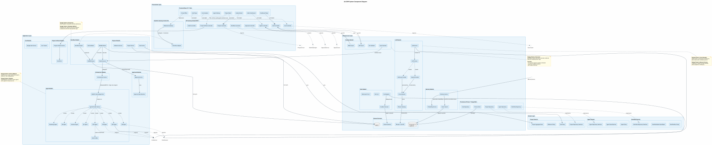
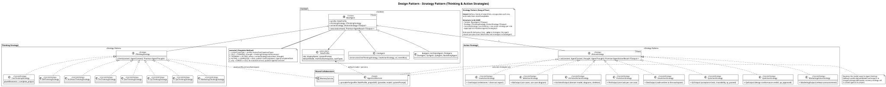
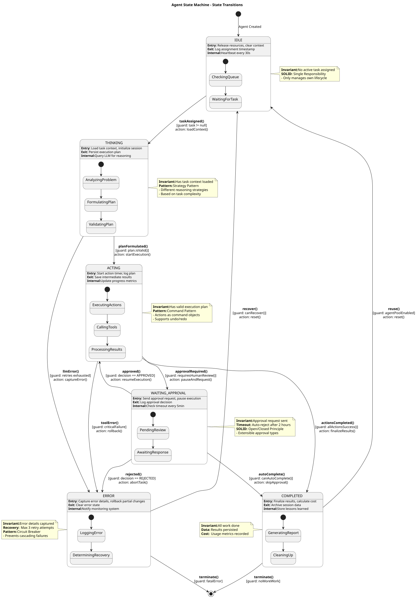
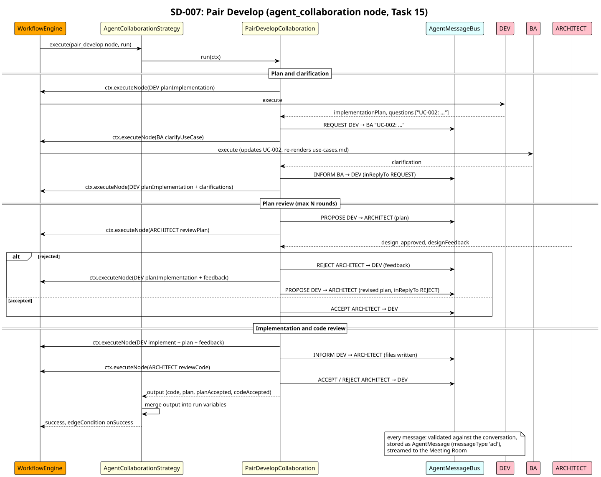
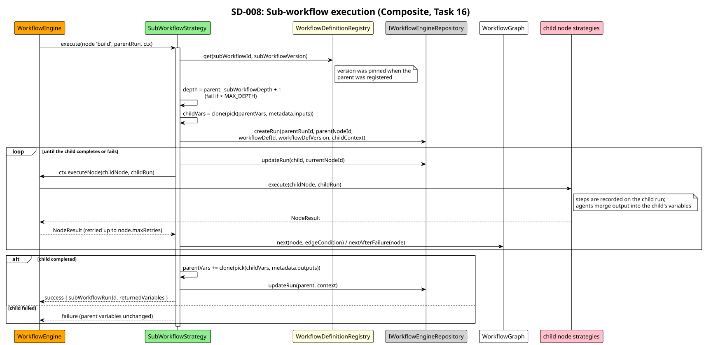
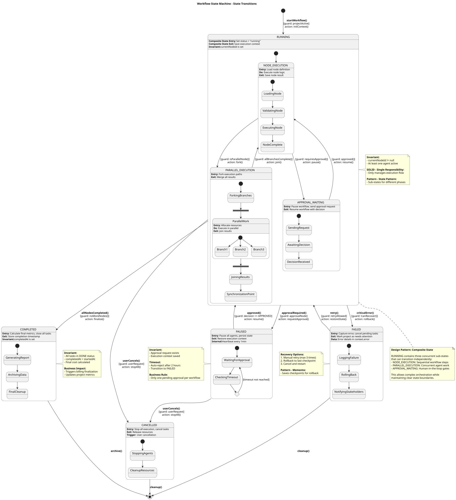
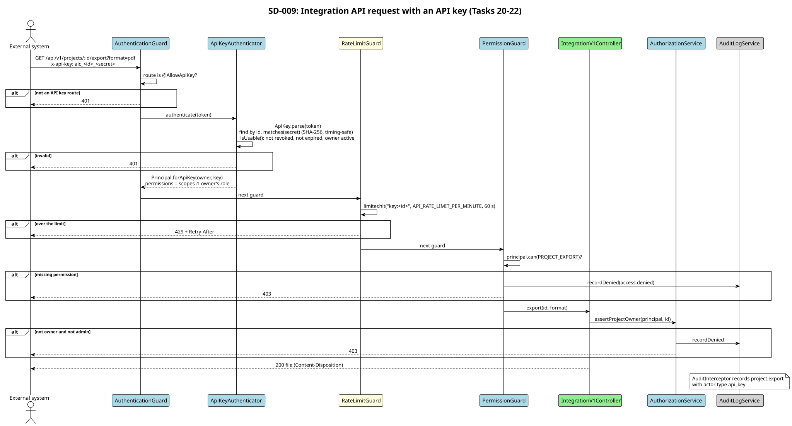
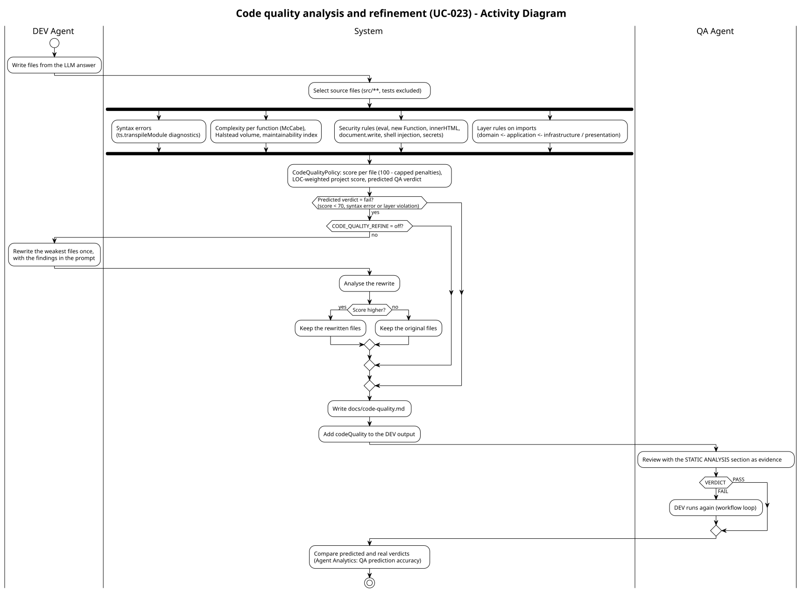

# Thiết kế hệ thống

Chương này trình bày thiết kế của nền tảng theo thứ tự từ tổng thể đến chi tiết: kiến trúc, mẫu thiết kế, tác tử, bộ máy quy trình, dữ liệu, cách áp dụng OOAD cho dự án sinh ra, bảo mật, phân tích và dự báo, và triển khai. Toàn bộ 39 sơ đồ UML được liệt kê ở Phụ lục A.

## Kiến trúc tổng thể

### Kiểu kiến trúc

Nền tảng gồm một máy chủ API (NestJS, TypeScript) và một ứng dụng web một trang (React). Bên trong API, mã được tổ chức theo **kiến trúc phân lớp kết hợp thiết kế hướng miền** [6], [8]:

| Tầng | Nội dung | Phụ thuộc được phép |
|------|----------|---------------------|
| Trình bày | Controller REST, cổng WebSocket (Socket.IO), DTO, guard | Ứng dụng |
| Ứng dụng | Dịch vụ ứng dụng (một use case một phương thức), chiến lược tác tử, bộ máy quy trình, trình xử lý sự kiện | Miền |
| Miền (`src/domain`) | Thực thể, value object, aggregate, sự kiện miền, máy trạng thái, giao diện Repository và các cổng (port), chính sách thuần (không I/O) | Không gì cả |
| Hạ tầng | Repository Prisma, nhà cung cấp LLM, sandbox Docker, kho tệp của dự án, phân tích mã TypeScript, xuất PDF | Miền (hiện thực các cổng) |

Tầng miền có 101 tệp và không nhập NestJS, Prisma hay bất kỳ thư viện I/O nào. Nhờ đó mọi quy tắc nghiệp vụ (chuyển trạng thái công việc, phép tính tiền, phát hiện bất thường, hồi quy dự báo, chính sách chất lượng mã) được kiểm thử như hàm thuần, và đây cũng là nơi đặt ngưỡng độ bao phủ cao nhất (mục 6.2).

{.wide}

### Các quyết định kiến trúc chính

Các quyết định được ghi thành bản ghi quyết định kiến trúc (ADR) trong `docs/design/architecture.md`. Sáu quyết định có ảnh hưởng lớn nhất:

1. **NestJS cho API** vì hệ thống tiêm phụ thuộc và mô-đun của nó hiện thực trực tiếp DIP và cho phép đăng ký nhiều hiện thực cho một token (dùng cho danh sách tác tử và chiến lược nút).
2. **PostgreSQL** cho dữ liệu quan hệ và JSON (ngữ cảnh lượt chạy, siêu dữ liệu OOAD), với **Prisma** làm lớp ánh xạ phía sau các Repository.
3. **BullMQ trên Redis** cho hàng đợi nút quy trình, với chế độ dự phòng thực thi trực tiếp khi không có Redis (sức khoẻ hệ thống báo *degraded* thay vì ngừng).
4. **Repository** cho mọi truy cập dữ liệu từ tầng ứng dụng, để dịch vụ ứng dụng kiểm thử được bằng Repository trong bộ nhớ.
5. **Strategy cho chuyên môn hoá tác tử** thay vì kế thừa sâu (mục 4.3).
6. **Sự kiện miền** cho giao tiếp giữa các mô-đun: nhật ký kiểm toán, webhook, học của tác tử, dự báo và giám sát bất thường đều là người nghe sự kiện, không mô-đun nào gọi trực tiếp mô-đun kia.

## Mẫu thiết kế

Bảng sau gắn mỗi mẫu với vấn đề nó giải quyết và lớp hiện thực. Mỗi lớp trong mã có chú thích `@pattern` tương ứng, nên bảng này có thể kiểm chứng bằng tìm kiếm trong kho mã.

| Vấn đề | Mẫu | Hiện thực |
|--------|-----|-----------|
| Tám vai trò cùng một chu trình nhận việc → suy nghĩ → hành động → hoàn tất | Template Method | `BaseAgent.execute()` |
| Mỗi vai trò suy nghĩ và hành động khác nhau, cần thay được độc lập | Strategy | `IThinkingStrategy`, `IActionStrategy`, 16 lớp chiến lược |
| Thêm vai trò mới không sửa bộ điều phối | Registry + DIP | `AgentOrchestrator` nhận danh sách `IAgent` qua token `AGENTS`; `RoleProfile` cho mỗi vai trò |
| Vòng đời tác tử, công việc, dự án, phê duyệt có chuyển trạng thái hợp lệ | State | `AgentStateMachine`, `Task.transitionTo`, value object `ProjectStatus` |
| Nhiều bên cần biết khi tác tử đổi trạng thái hoặc hoàn tất | Observer | `AgentEventEmitter` / `IAgentObserver`; `EventBus` với các handler |
| Mỗi loại nút quy trình thực thi khác nhau, thêm loại nút không sửa bộ máy | Strategy (tự đăng ký) | `NodeExecutionStrategy`: tác tử, quy trình con, cổng chất lượng, điều kiện, song song, phê duyệt |
| Một nút là cả một quy trình | Composite | `SubWorkflowStrategy` chạy quy trình con như lượt chạy con |
| Quay lại trạng thái trước của lượt chạy | Memento | `WorkflowRunMemento`, `WorkflowSnapshotCaretaker` |
| Định nghĩa quy trình không bị sửa sau khi đã có lượt chạy dùng nó | Immutable registry | `WorkflowDefinitionRegistry` theo `id@phiên_bản+băm` |
| Ghi chi phí mọi lời gọi LLM mà không sửa nhà cung cấp | Decorator | `UsageTrackingLLMProvider` |
| Tác tử gọi LLM qua một điểm duy nhất (cấu hình, nhà cung cấp, chi phí) | Facade | `AgentLLMService`, `OoadArtifactService`, `CodeQualityService` |
| Nhiều nhà cung cấp LLM sau một giao diện | Adapter + Factory Method | `ILLMProvider`, `LLMProviderFactory` |
| Tác tử trao đổi thông điệp có kiểu khi cộng tác | Mediator | `AgentMessageBus`, `EventBus` |
| Xác thực → giới hạn tần suất → kiểm quyền | Chain of Responsibility | `AuthenticationGuard` → `RateLimitGuard` → `PermissionGuard`; chuỗi rà soát QC → QA |
| Sự kiện miền thành mục kiểm toán hoặc payload webhook công khai | Adapter | `AuditLogHandler`, `webhook-payloads` |
| Truy cập dữ liệu tách khỏi miền | Repository, Data Mapper | `I*Repository` trong miền, `Prisma*Repository` trong hạ tầng |
| Báo cáo chi phí và hiệu năng dựng từng bước | Builder | `CostReportBuilder`, `PerformanceReportBuilder` |
| Xuất JSON / CSV / PDF chọn theo định dạng | Strategy + Registry | `ProjectExportService` và ba exporter |
| Mỗi loại bất thường, mỗi tín hiệu chất lượng là một quy tắc | Strategy + Composite | `IAgentAnomalyRule`, `IQualitySignal`, `AgentAnomalyDetector` |
| Phân tích mã sinh ra mà miền không phụ thuộc trình biên dịch | Port / Adapter | `ICodeAnalyzer` (miền) ← `TypeScriptCodeAnalyzer` (hạ tầng) |
| Quy tắc chấm điểm chất lượng mã | Policy / Specification | `CodeQualityPolicy`, `LayerRules` |

{.wide}

## Thiết kế tác tử

### Template Method và hai chiến lược

Mỗi tác tử là một đối tượng `BaseAgent` được cấu hình bằng ba thứ: một `RoleProfile` (vai trò, các loại công việc hỗ trợ, loại công việc mặc định, lời nhắc hệ thống), một chiến lược tư duy và một chiến lược hành động. `BaseAgent.execute()` cố định khung thuật toán:

1. Chuẩn hoá ngữ cảnh: loại công việc được đối chiếu với hồ sơ vai trò, nên chiến lược luôn nhận một loại công việc vai trò đó hỗ trợ.
2. Phát `TaskAssignedEvent`.
3. Chuyển `IDLE → THINKING`, gọi `thinkingStrategy.think(context)`: nạp bộ nhớ và bài học liên quan, gọi LLM để lập kế hoạch.
4. Chuyển `THINKING → ACTING`, gọi `actionStrategy.act(context, thought)`: sinh tài liệu hoặc mã, ghi vào kho tệp của dự án, chạy công cụ.
5. Chuyển `ACTING → COMPLETED → IDLE`, lưu ký ức, phát `AgentCompletedTaskEvent`.
6. Khi có ngoại lệ: chuyển sang `ERROR`; lỗi tạm thời cho phép quay lại `IDLE`.

Thiết kế này thoả SRP (tác tử chỉ điều phối vòng đời, chiến lược chứa chuyên môn), OCP (thêm vai trò là thêm hồ sơ và hai chiến lược) và LSP (mọi tác tử thay thế được cho nhau qua `IAgent`).

### Máy trạng thái theo từng lần thực thi

Ban đầu mỗi vai trò giữ một máy trạng thái duy nhất. Kiểm thử phát hiện hai hậu quả: hai công việc cùng vai trò chạy đồng thời làm hỏng nhau ("Invalid state transition: IDLE → ERROR"), và sau một lỗi vĩnh viễn vai trò kẹt ở `ERROR`, từ chối mọi công việc sau đó. Thiết kế đã sửa: **mỗi lần `execute()` có một máy trạng thái riêng**, tác tử giữ tập các máy đang chạy và báo trạng thái của lần gần nhất. Đây là một ví dụ về việc mẫu State phải gắn với đúng đối tượng có vòng đời (lần thực thi), không phải đối tượng tồn tại lâu (tác tử).



### Gọi LLM và ghi chi phí

Chiến lược không gọi nhà cung cấp LLM trực tiếp. `AgentLLMService` (Facade) tra cấu hình mô hình của vai trò, lấy nhà cung cấp từ `LLMProviderFactory` và bọc nó bằng `UsageTrackingLLMProvider` (Decorator). Decorator chuyển nguyên lời gọi rồi ghi số token và chi phí vào `ApiUsageLog`, cộng vào chi phí của dự án, và phát `BudgetExceededEvent` một lần khi vượt ngân sách. Nhờ vậy chi phí của cả tám vai trò được ghi đầy đủ mà không chiến lược nào phải biết về chi phí.

### Học từ kết quả

Cơ chế học gồm ba phần:

1. `OutcomeSignalPolicy` (chính sách thuần) quyết định tín hiệu nào chấm lần thực thi nào: kết quả cổng OOAD chấm BA và Architect; kết quả của QC (kiểm thử đạt, use case thiếu) chấm DEV; phán quyết QA chấm DEV và QC.
2. `LearningService` lưu mỗi kết quả vào bộ nhớ của vai trò; cứ mỗi N kết quả (mặc định 3) nó tinh luyện các kết quả gần đây thành một ký ức `lessons_learned` bằng một lời gọi LLM, được tính chi phí như mọi lời gọi khác.
3. Chiến lược tư duy nạp các bài học trước tiên khi xây lời nhắc.

Thiết kế này gần với Reflexion [28] ở chỗ phản hồi bằng ngôn ngữ, nhưng tín hiệu là khách quan (cổng, kiểm thử, phán quyết) chứ không do chính tác tử tự đánh giá.

### Cộng tác giữa các tác tử

Ba mẫu cộng tác là các chiến lược của một nút quy trình, đăng ký trong `CollaborationRegistry`:

- **Lập trình cặp** (`pair_develop`): DEV lập kế hoạch; câu hỏi về use case mơ hồ được gửi BA trước (vòng làm rõ); DEV gửi `PROPOSE`, Architect `ACCEPT` hoặc `REJECT` kèm phản hồi; sau khi hiện thực, Architect rà soát mã. Số vòng có giới hạn để chi phí bị chặn.
- **Vòng làm rõ** (`clarification_loop`): tác tử hỏi BA và nhận câu trả lời trước khi tiếp tục.
- **Chuỗi rà soát** (`review_chain`, Chain of Responsibility): QC rồi QA; một mắt xích từ chối thì dừng chuỗi.

Mọi lượt trao đổi đi qua `AgentMessageBus` (Mediator) với các performative theo tinh thần FIPA-ACL [16], và được hiển thị trong Phòng họp (Meeting Room) của giao diện.

{.wide}

## Thiết kế bộ máy quy trình

### Định nghĩa và thực thi

Một quy trình là một đồ thị gồm các nút có kiểu và các cạnh (mặc định, có điều kiện, `onFail`). `WorkflowEngine` không chứa logic của từng loại nút: mỗi loại là một `NodeExecutionStrategy` tự đăng ký với bộ máy. Thêm loại nút (ví dụ cổng chất lượng) là thêm một lớp, không sửa bộ máy (OCP).

Quy trình mặc định cho một dự án phần mềm:

```
CEO (mốc)
 → [quy trình con: phân tích & thiết kế]  BA → Architect → cổng OOAD ─không đạt→ Architect
 → PM (một công việc cho mỗi use case)
 → [quy trình con: xây dựng & kiểm chứng] DEV → QC → QA → [điều kiện qa_approved] ─không đạt→ DEV
 → Marketing → [phê duyệt của con người] → CEO (đóng dự án)
```

### Quy trình con, phiên bản và khôi phục

- **Quy trình con (Composite):** nút `sub_workflow` chạy một quy trình khác như một lượt chạy con có `parentRunId`; kết quả của lượt con được gộp vào ngữ cảnh lượt cha. Ba mẫu quy trình có kiểu (dự án phần mềm OOAD, backend REST API, chỉ phân tích và thiết kế) dùng chung các quy trình con.
- **Phiên bản bất biến:** mỗi định nghĩa được lưu theo `id@phiên_bản` cùng mã băm của nội dung chuẩn hoá; đăng ký lại cùng phiên bản với nội dung khác bị từ chối. Mỗi lượt chạy ghim một phiên bản cụ thể.
- **Ảnh chụp và khôi phục (Memento):** sau mỗi nút, `WorkflowSnapshotCaretaker` lưu một memento gồm nút hiện tại, ngữ cảnh và trạng thái; người dùng có thể khôi phục một lượt chạy đang tạm dừng về một ảnh chụp, các phê duyệt treo sau ảnh chụp đó bị huỷ.
- **Song song có phụ thuộc:** nút `parallel` chạy các nhánh theo thứ tự tô-pô của `dependsOn` với giới hạn đồng thời; `DependencyResolver` phát hiện chu trình.

{.wide}

### Xử lý lỗi

Một nút thất bại được thử lại tối đa ba lần với giãn cách mũ. Nếu vẫn thất bại, lượt chạy đi theo cạnh `onFail` nếu có, ngược lại chuyển sang `failed` và phát `workflow.failed`. Hai lỗi thiết kế đã được kiểm thử phát hiện và sửa: nút thất bại từng để lượt chạy BullMQ ở trạng thái `running` mãi mãi, và từng đi tiếp theo cạnh thành công.

{.wide}

## Thiết kế dữ liệu và lưu trữ

Dữ liệu có cấu trúc nằm trong PostgreSQL qua 20 mô hình Prisma (người dùng, dự án, mốc, công việc, tác tử, bộ nhớ, lượt chạy, bước, ảnh chụp, phiên bản định nghĩa, phê duyệt, nhật ký sử dụng API, nhật ký cổng chất lượng, nhật ký kiểm toán, khoá API, webhook, lần gửi webhook, dự báo…). Lược đồ được quản lý bằng migration có phiên bản; một bước kiểm tra so lược đồ dựng từ migration với mô hình để phát hiện lệch.

Sản phẩm của tác tử (tài liệu, sơ đồ, mã, kiểm thử, báo cáo) **không** nằm trong cơ sở dữ liệu mà trong `ProjectWorkspace`: một thư mục bền vững cho mỗi dự án, có kiểm tra chống thoát thư mục (đường dẫn `../../etc/...` do LLM đề xuất bị từ chối). Thiết kế ban đầu ghi sản phẩm vào sandbox Docker, vốn chạy mỗi lệnh trong một container mới không có ổ gắn, nên mọi tệp bị mất sau mỗi lệnh; đây là lý do cổng chất lượng và việc quét kiểm thử trước đó không bao giờ thành công.

## Áp dụng OOAD cho dự án sinh ra

Đây là đóng góp đặc thù của nền tảng: mọi dự án đi qua cùng một chuỗi OOAD và chuỗi đó được **kiểm tra**, không chỉ được sinh ra.

### Chuỗi sản phẩm

| Bước | Tác tử | Sản phẩm trong kho tệp của dự án |
|------|--------|----------------------------------|
| Yêu cầu | BA | `docs/use-cases.md` |
| Mô hình miền và UML | Architect | `docs/domain-model.puml`, `docs/use-case-diagram.puml`, `docs/class-diagram.puml`, `docs/sequence-UC-xxx.puml`, `docs/architecture-patterns.md`, `ARCHITECTURE.md` |
| Khung mã | Architect | `src/domain/{entities,value-objects,repositories}`, `src/application/services`, `src/infrastructure/persistence`, `src/presentation/controllers`, `src/composition-root.ts` |
| Hiện thực | DEV | Mã đầy đủ trong khung, chú thích `UC-xxx` |
| Chất lượng mã | Hệ thống | `docs/code-quality.md` |
| Kiểm thử | QC | `tests/UC-xxx.spec.ts`, kết quả Jest |
| Truy vết | QC | `docs/traceability-matrix.md` |

Khung mã dựng từ mẫu Handlebars theo đúng bốn tầng; giao diện Repository nằm trong miền, hiện thực trong hạ tầng, và một `composition-root.ts` lắp ghép phụ thuộc. Như vậy kiến trúc mà nền tảng dùng cho chính nó cũng là kiến trúc nó đòi hỏi ở sản phẩm.

### Ba lớp kiểm tra

1. **Cổng OOAD** (nút `quality_gate` sau thiết kế): kiểm tra số use case, số thực thể miền, số mẫu thiết kế đạt ngưỡng và các tệp bắt buộc tồn tại. Không đạt thì quay lại Architect. Mỗi lần đánh giá ghi vào `QualityGateLog` và phát `QualityGateEvaluatedEvent`.
2. **Phân tích tĩnh trước QA** (mục 4.8.3): trong đó có luật phân lớp *miền ← ứng dụng ← hạ tầng/trình bày*; một lệnh `import` hoặc `require()` từ miền vào hạ tầng là vi phạm.
3. **Kiểm thử chấp nhận đã thực thi**: độ bao phủ use case chỉ tính các use case có kiểm thử chạy đạt; use case thiếu kiểm thử hoặc kiểm thử thất bại được liệt kê đích danh.

## Bảo mật và tính năng doanh nghiệp

- **Chuỗi guard toàn cục** (Chain of Responsibility): `AuthenticationGuard` (JWT [49] cho người dùng, khoá API cho `/api/v1`) → `RateLimitGuard` → `PermissionGuard`. Mặc định mọi route cần đăng nhập; route công khai phải đánh dấu `@Public`.
- **Quyền sở hữu**: `AuthorizationService` kiểm tra chủ dự án và người được giao phê duyệt; vi phạm trả 403 và ghi `access.denied`.
- **Nhật ký kiểm toán chỉ ghi thêm**: decorator `@Audited` cùng `AuditInterceptor` ghi hành động của người dùng; `AuditLogHandler` ghi hành động của hệ thống và tác tử từ sự kiện miền. Mật khẩu, token, bí mật và khoá bị che trước khi ghi.
- **API tích hợp**: khoá API chỉ mang các phạm vi mà vai trò hiện tại của chủ khoá cho phép (giao của hai tập); giới hạn tần suất theo khoá; tài liệu OpenAPI ở `/api/docs` (có thể tắt trong production).
- **Webhook**: payload ký HMAC-SHA256 [48] kèm dấu thời gian, URL tới mạng nội bộ bị từ chối cả sau khi phân giải DNS (chống SSRF [50]), gửi lại với giãn cách mũ.
- **Phê duyệt chỉ qua REST**: kiểm thử đầu-cuối của cấu hình triển khai phát hiện rằng giao diện gửi quyết định phê duyệt qua WebSocket, và cổng WebSocket chấp nhận quyết định từ bất kỳ kết nối nào: người xem, vốn nhận 403 từ REST, vẫn duyệt được và dự án được đóng mà không có mục kiểm toán. Thiết kế đã sửa: quyết định chỉ đi qua `POST /api/approvals/:id/approve|reject` (kiểm quyền, kiểm người được giao, ghi kiểm toán), thông điệp WebSocket tương ứng bị từ chối.
- **Cấu hình production an toàn**: với `NODE_ENV=production`, API không khởi động nếu thiếu `JWT_SECRET` (hoặc ngắn hơn 32 ký tự), thiếu `CORS_ORIGIN` hoặc còn giá trị giữ chỗ như `CHANGE_ME`. Mọi nơi đọc khoá JWT (REST, guard WebSocket, cổng WebSocket) dùng chung một hàm; trước đó ba nơi có ba giá trị dự phòng khác nhau, nên khi không đặt `JWT_SECRET` kết nối thời gian thực luôn bị từ chối.

{.wide}

## Phân tích, dự báo và chất lượng mã

### Phân tích hiệu năng tác tử

`AgentPerformanceAnalyzer` (miền, thuần) tính cho mỗi vai trò: số bước, tỉ lệ thành công, thời lượng trung bình và p95, chi phí trên mỗi lần thành công, chất lượng, xu hướng so với kỳ trước và thứ hạng. Điểm thiết kế quan trọng là **chất lượng được đo theo vai trò** bằng các `IQualitySignal` khác nhau: DEV theo tỉ lệ được QA duyệt, QC theo kết quả kiểm thử, Architect theo cổng OOAD, các vai trò khác theo tỉ lệ thành công ngay lần đầu. `AgentAnomalyDetector` áp dụng năm quy tắc (tỉ lệ thành công giảm 20 điểm, ba lần thất bại liên tiếp, chi phí gấp đôi, chậm gấp đôi, chất lượng dưới 50%); mỗi bất thường được phát một lần mỗi ngày qua cùng đường sự kiện, kiểm toán và webhook.

### Dự báo thời gian và chi phí

Nền tảng không ghi giờ công của con người; cái nó ghi là thời lượng và chi phí LLM của từng bước tác tử. Vì vậy mô hình dự báo **thời gian tác tử và chi phí LLM theo dự án và vai trò**, không phải giờ công của từng công việc. Mỗi vai trò có một hồi quy ridge [40] trên hai đặc trưng (độ dài mô tả, số use case); khi một vai trò có ít hơn 6 mẫu, mô hình dùng trung vị. Độ chính xác được báo bằng sai số leave-one-out (MAPE và MAE) [46], và mỗi dự báo mang mức tin cậy. Dự báo được lưu khi quy trình bắt đầu và khi PM lập kế hoạch, rồi được so với kết quả khi dự án xong. Chi phí ước lượng của mỗi công việc mà PM tạo được suy ra từ dự báo của DEV, QC và QA.

### Phân tích tĩnh và vòng sửa có giới hạn

`TypeScriptCodeAnalyzer` (hạ tầng, sau cổng `ICodeAnalyzer`) dùng TypeScript compiler API để tính: lỗi cú pháp, độ phức tạp McCabe từng hàm [35], thể tích Halstead [36], chỉ số bảo trì chuẩn hoá [37], [38], lời gọi không an toàn (`eval`, `Function`), bí mật viết cứng, vi phạm phân lớp và tham chiếu use case. `CodeQualityPolicy` (miền) trừ điểm có trần cho mỗi loại vấn đề, tính điểm trung bình có trọng số theo số dòng, và **dự đoán phán quyết QA** là *fail* khi điểm dưới 70, có lỗi cú pháp hoặc có vi phạm phân lớp. Khi dự đoán là *fail*, DEV được cho **đúng một** vòng sửa kèm danh sách vấn đề; bản sửa chỉ được giữ nếu điểm tăng. QA nhận báo cáo phân tích làm bằng chứng khi rà soát. Dự đoán được đối chiếu với phán quyết thật để đo độ chính xác thay vì được khẳng định.



## Thiết kế triển khai

Hệ thống triển khai bằng Docker Compose trên một máy chủ: nginx phục vụ ứng dụng web và làm proxy ngược cho `/api`, `/socket.io` và `/plantuml`; API (Node 20) chạy migration khi khởi động rồi phục vụ; PostgreSQL (có pgvector), Redis (AOF) và máy chủ PlantUML nội bộ; kho tệp của dự án là một volume. Chỉ nginx được công bố ra ngoài. Một hồ sơ `demo` thêm LLM kịch bản để trình diễn ngoại tuyến. API có hai điểm kiểm tra sức khoẻ [54]: `/api/health/live` (tiến trình còn trả lời, dùng cho HEALTHCHECK của Docker) và `/api/health` (sẵn sàng: trả 503 khi mất cơ sở dữ liệu, *degraded* khi mất Redis hoặc cổng LLM).

{.wide}
