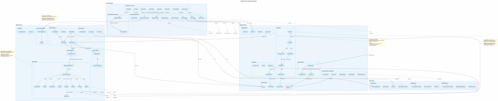
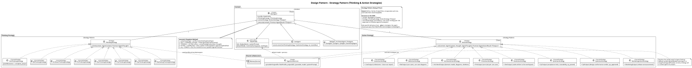
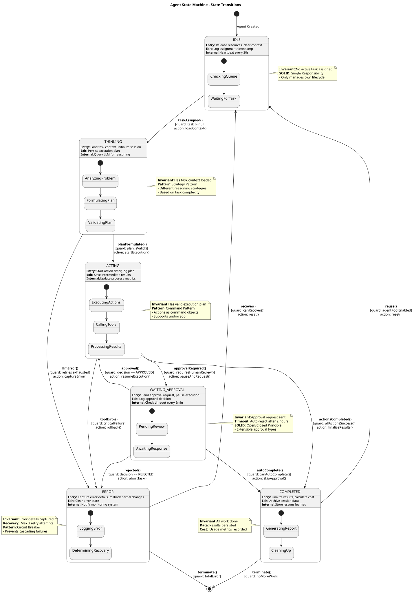
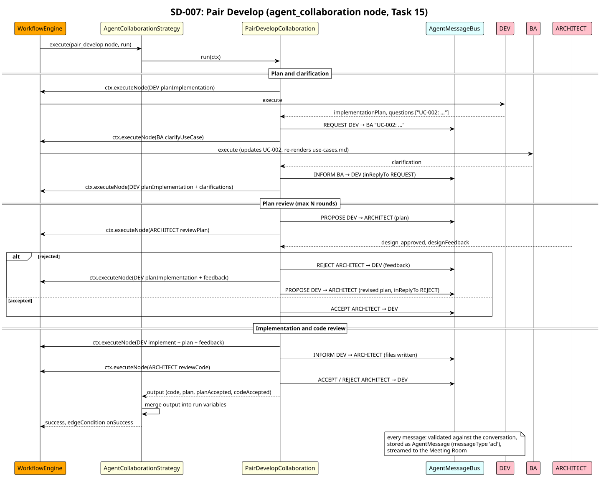
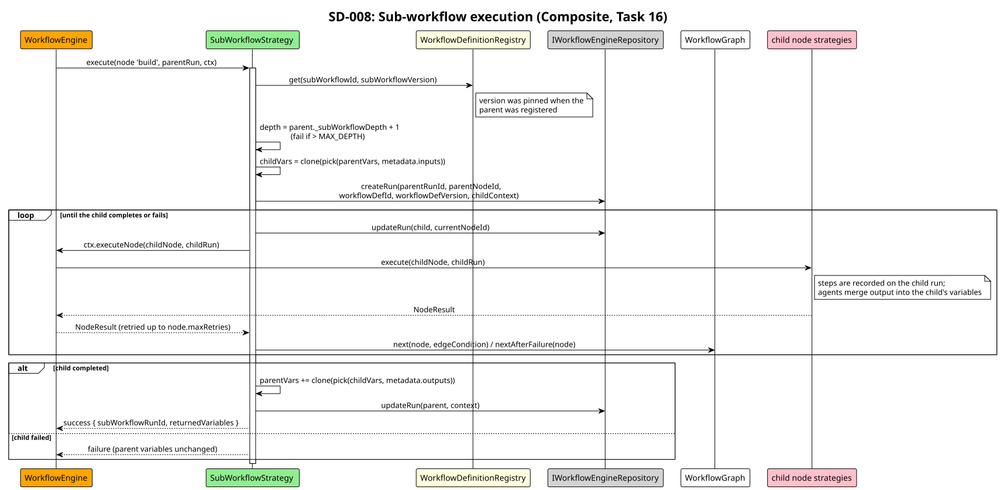
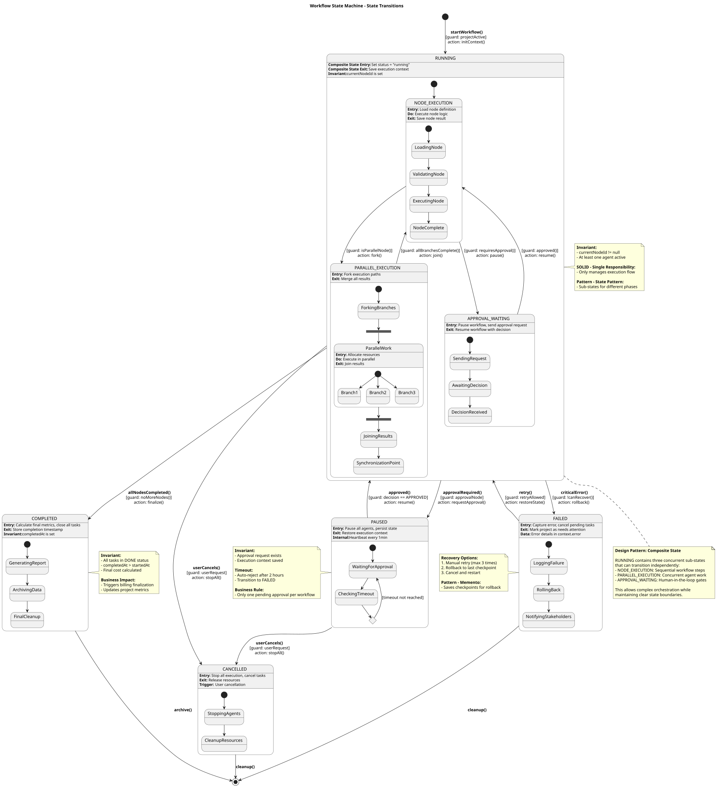
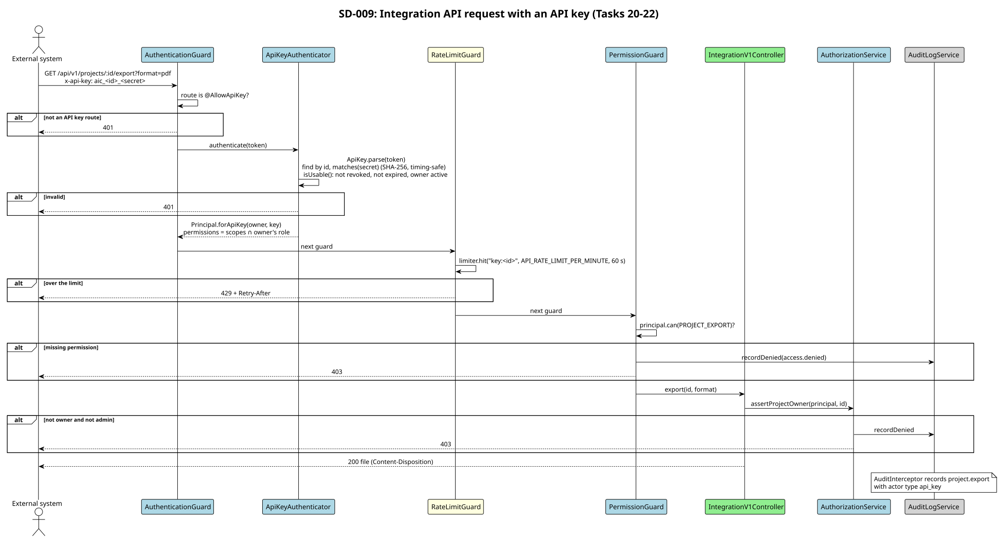
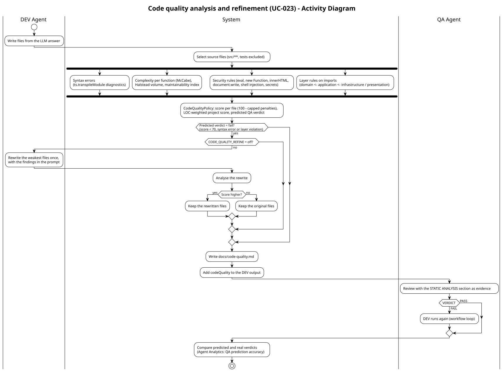
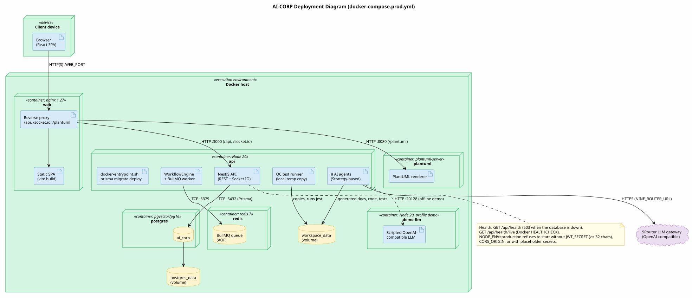

# Thiết kế hệ thống

Chương này trình bày thiết kế của nền tảng theo trình tự từ tổng thể đến chi tiết, gồm kiến trúc, mẫu thiết kế, thiết kế tác tử, bộ máy quy trình, dữ liệu, cách áp dụng OOAD cho các dự án sinh ra, bảo mật, phân tích và dự báo, và cuối cùng là triển khai. Danh sách đầy đủ 39 sơ đồ UML được trình bày ở Phụ lục A.

## Kiến trúc tổng thể

### Kiểu kiến trúc

Nền tảng gồm một máy chủ API (NestJS, TypeScript) và một ứng dụng web một trang (React). Bên trong API, mã nguồn được tổ chức theo kiến trúc phân lớp kết hợp với thiết kế hướng miền [6], [8], như trình bày trong bảng sau.

| Tầng | Nội dung | Phụ thuộc được phép |
|------|----------|---------------------|
| Trình bày | Controller REST, cổng WebSocket (Socket.IO), DTO, guard | Ứng dụng |
| Ứng dụng | Dịch vụ ứng dụng (một use case một phương thức), chiến lược tác tử, bộ máy quy trình, trình xử lý sự kiện | Miền |
| Miền (`src/domain`) | Thực thể, value object, aggregate, sự kiện miền, máy trạng thái, giao diện Repository và các cổng (port), chính sách thuần (không I/O) | Không gì cả |
| Hạ tầng | Repository Prisma, nhà cung cấp LLM, sandbox Docker, kho tệp của dự án, phân tích mã TypeScript, xuất PDF | Miền (hiện thực các cổng) |

Tầng miền gồm 106 tệp và không nhập NestJS, Prisma hay bất kỳ thư viện I/O nào. Nhờ đó, mọi quy tắc nghiệp vụ (chuyển trạng thái công việc, tính toán tiền tệ, phát hiện bất thường, hồi quy dự báo, chính sách chất lượng mã) đều được kiểm thử như các hàm thuần. Tầng miền cũng là nơi áp dụng ngưỡng độ bao phủ cao nhất (mục 6.2).

{.wide}

### Các quyết định kiến trúc chính

Các quyết định kiến trúc được ghi thành các bản ghi quyết định kiến trúc (ADR) trong tệp `docs/design/architecture.md`. Sáu quyết định có ảnh hưởng lớn nhất là:

1. Dùng NestJS cho API, vì cơ chế tiêm phụ thuộc và hệ thống mô-đun của NestJS hiện thực trực tiếp nguyên lý DIP và cho phép đăng ký nhiều hiện thực cho cùng một token (được dùng cho danh sách tác tử và danh sách chiến lược nút).
2. Dùng PostgreSQL cho dữ liệu quan hệ và dữ liệu JSON (ngữ cảnh lượt chạy, siêu dữ liệu OOAD), với Prisma làm lớp ánh xạ phía sau các Repository.
3. Dùng BullMQ trên Redis làm hàng đợi cho các nút quy trình, kèm chế độ dự phòng thực thi trực tiếp khi không có Redis; khi đó điểm kiểm tra sức khoẻ báo trạng thái *degraded* và hệ thống vẫn tiếp tục hoạt động.
4. Mọi truy cập dữ liệu từ tầng ứng dụng đều đi qua Repository, nhờ đó các dịch vụ ứng dụng kiểm thử được bằng Repository trong bộ nhớ.
5. Dùng mẫu Strategy để chuyên môn hoá tác tử, thay cho cây kế thừa sâu (mục 4.3).
6. Các mô-đun giao tiếp với nhau qua sự kiện miền. Nhật ký kiểm toán, webhook, cơ chế học của tác tử, dự báo và giám sát bất thường đều là bộ lắng nghe sự kiện, và các mô-đun này không gọi trực tiếp lẫn nhau.

## Mẫu thiết kế

Bảng dưới đây gắn mỗi mẫu thiết kế với vấn đề mà mẫu đó giải quyết và lớp hiện thực tương ứng. Mỗi lớp trong mã nguồn đều có chú thích `@pattern`, vì vậy có thể kiểm chứng nội dung bảng bằng cách tìm kiếm trong kho mã.

| Vấn đề | Mẫu | Hiện thực |
|--------|-----|-----------|
| Tám vai trò có chung chu trình nhận việc, suy nghĩ, hành động và hoàn tất | Template Method | `BaseAgent.execute()` |
| Mỗi vai trò suy nghĩ và hành động khác nhau, cần thay được độc lập | Strategy | `IThinkingStrategy`, `IActionStrategy`, 16 lớp chiến lược |
| Thêm vai trò mới không sửa bộ điều phối | Registry + DIP | `AgentOrchestrator` nhận danh sách `IAgent` qua token `AGENTS`; `RoleProfile` cho mỗi vai trò |
| Vòng đời tác tử, công việc, dự án, phê duyệt có chuyển trạng thái hợp lệ | State | `AgentStateMachine`, `Task.transitionTo`, value object `ProjectStatus` |
| Nhiều bên cần biết khi tác tử đổi trạng thái hoặc hoàn tất | Observer | `AgentEventEmitter` / `IAgentObserver`; `EventBus` với các handler |
| Mỗi loại nút quy trình thực thi khác nhau, thêm loại nút không sửa bộ máy | Strategy (tự đăng ký) | `NodeExecutionStrategy`: tác tử, quy trình con, cổng chất lượng, điều kiện, song song, phê duyệt |
| Một nút là cả một quy trình | Composite | `SubWorkflowStrategy` chạy quy trình con như lượt chạy con |
| Quay lại trạng thái trước của lượt chạy | Memento | `WorkflowRunMemento`, `WorkflowSnapshotCaretaker` |
| Định nghĩa quy trình không bị sửa sau khi đã có lượt chạy dùng nó | Immutable registry | `WorkflowDefinitionRegistry` theo `id@phiên_bản+băm` |
| Ghi chi phí mọi lời gọi LLM mà không sửa nhà cung cấp | Decorator | `UsageTrackingLLMProvider` |
| Tác tử gọi LLM qua một điểm duy nhất (cấu hình, nhà cung cấp, chi phí) | Facade | `AgentLLMService`, `OoadArtifactService`, `CodeQualityService` |
| Nhiều nhà cung cấp LLM sau một giao diện | Adapter + Factory Method | `ILLMProvider`, `LLMProviderFactory` |
| Quản trị viên thêm nhà cung cấp và mô hình lúc chạy, mỗi loại nhà cung cấp tạo client khác nhau | Aggregate + Strategy + Registry | `LlmProviderConfig` (sở hữu `LlmModel`), `ProviderStrategy` cho mỗi loại, `ProviderStrategyRegistry`, `ConfiguredProviderRegistry` |
| Khoá API của nhà cung cấp được mã hoá mà miền không phụ thuộc thư viện mật mã | Port / Adapter | `SecretCipher` (miền) ← `AesGcmSecretCipher` (hạ tầng) |
| Một phê duyệt chỉ được trả lời một lần dù có hai yêu cầu đồng thời | Cập nhật có điều kiện (compare-and-set) | `ApprovalService`: cập nhật chỉ khi trạng thái còn `pending` |
| Tác tử trao đổi thông điệp có kiểu khi cộng tác | Mediator | `AgentMessageBus`, `EventBus` |
| Xác thực, giới hạn tần suất rồi kiểm tra quyền | Chain of Responsibility | `AuthenticationGuard` → `RateLimitGuard` → `PermissionGuard`; chuỗi rà soát QC → QA |
| Sự kiện miền thành mục kiểm toán hoặc payload webhook công khai | Adapter | `AuditLogHandler`, `webhook-payloads` |
| Truy cập dữ liệu tách khỏi miền | Repository, Data Mapper | `I*Repository` trong miền, `Prisma*Repository` trong hạ tầng |
| Báo cáo chi phí và hiệu năng dựng từng bước | Builder | `CostReportBuilder`, `PerformanceReportBuilder` |
| Xuất JSON / CSV / PDF chọn theo định dạng | Strategy + Registry | `ProjectExportService` và ba exporter |
| Mỗi loại bất thường, mỗi tín hiệu chất lượng là một quy tắc | Strategy + Composite | `IAgentAnomalyRule`, `IQualitySignal`, `AgentAnomalyDetector` |
| Phân tích mã sinh ra mà miền không phụ thuộc trình biên dịch | Port / Adapter | `ICodeAnalyzer` (miền) ← `TypeScriptCodeAnalyzer` (hạ tầng) |
| Quy tắc chấm điểm chất lượng mã | Policy / Specification | `CodeQualityPolicy`, `LayerRules` |

{.wide}

## Thiết kế tác tử

### Template Method và hai chiến lược

Mỗi tác tử là một đối tượng `BaseAgent` được cấu hình bằng ba thành phần: một `RoleProfile` (vai trò, các loại công việc được hỗ trợ, loại công việc mặc định, lời nhắc hệ thống), một chiến lược tư duy và một chiến lược hành động. Phương thức `BaseAgent.execute()` cố định khung thuật toán gồm các bước sau:

1. Chuẩn hoá ngữ cảnh: loại công việc được đối chiếu với hồ sơ vai trò, nhờ đó chiến lược luôn nhận được một loại công việc mà vai trò hỗ trợ.
2. Phát `TaskAssignedEvent`.
3. Chuyển trạng thái `IDLE → THINKING` và gọi `thinkingStrategy.think(context)`: nạp bộ nhớ và các bài học liên quan, sau đó gọi LLM để lập kế hoạch.
4. Chuyển trạng thái `THINKING → ACTING` và gọi `actionStrategy.act(context, thought)`: sinh tài liệu hoặc mã nguồn, ghi vào kho tệp của dự án và chạy các công cụ cần thiết.
5. Chuyển trạng thái `ACTING → COMPLETED → IDLE`, lưu ký ức và phát `AgentCompletedTaskEvent`.
6. Khi có ngoại lệ, tác tử chuyển sang trạng thái `ERROR`; với lỗi tạm thời, tác tử được phép quay lại `IDLE`.

Thiết kế này thoả mãn SRP (tác tử chỉ điều phối vòng đời, còn chuyên môn nằm trong các chiến lược), OCP (thêm một vai trò chỉ cần thêm một hồ sơ và hai chiến lược) và LSP (mọi tác tử có thể thay thế cho nhau thông qua giao diện `IAgent`).

### Máy trạng thái theo từng lần thực thi

Trong thiết kế ban đầu, mỗi vai trò chỉ giữ một máy trạng thái duy nhất. Kiểm thử đã phát hiện hai hậu quả của cách làm này. Thứ nhất, hai công việc cùng vai trò chạy đồng thời làm hỏng trạng thái của nhau (lỗi "Invalid state transition: IDLE → ERROR"). Thứ hai, sau một lỗi vĩnh viễn, vai trò bị kẹt ở trạng thái `ERROR` và từ chối mọi công việc sau đó. Trong thiết kế đã sửa, mỗi lần gọi `execute()` có một máy trạng thái riêng; tác tử giữ tập các máy trạng thái đang chạy và báo cáo trạng thái của lần thực thi gần nhất. Trường hợp này cho thấy mẫu State cần được gắn với đối tượng thực sự có vòng đời, ở đây là lần thực thi, thay vì với đối tượng tồn tại lâu dài là tác tử.



### Gọi LLM và ghi chi phí

Các chiến lược không gọi trực tiếp nhà cung cấp LLM. `AgentLLMService` (mẫu Facade) tra cứu cấu hình mô hình của vai trò, lấy nhà cung cấp từ `LLMProviderFactory` và bọc nhà cung cấp đó bằng `UsageTrackingLLMProvider` (mẫu Decorator). Decorator chuyển tiếp nguyên vẹn lời gọi, sau đó ghi số token và chi phí vào `ApiUsageLog`, cộng vào chi phí của dự án và phát sự kiện `BudgetExceededEvent` một lần khi vượt ngân sách. Nhờ vậy, chi phí của cả tám vai trò được ghi nhận đầy đủ mà không chiến lược nào phải xử lý việc tính chi phí.

Nhà cung cấp và mô hình LLM được quản lý ngay trong ứng dụng, ngoài cách cấu hình qua biến môi trường. `LlmProviderConfig` là một aggregate root: đối tượng này sở hữu danh sách `LlmModel`, kiểm tra các bất biến (tên dài từ 1 đến 60 ký tự, URL http hoặc https hợp lệ, loại nhà cung cấp đã được hỗ trợ, không có mô hình trùng lặp) và chỉ lưu khoá API ở dạng đã mã hoá. Việc mã hoá đi qua cổng `SecretCipher` của tầng miền; tầng hạ tầng hiện thực cổng này bằng thuật toán AES-256-GCM với khoá `LLM_SECRET_KEY`, và API chỉ trả về bốn ký tự cuối của khoá. Mỗi loại nhà cung cấp (tương thích OpenAI, Anthropic) là một `ProviderStrategy` có khả năng tạo client, kiểm tra kết nối và lấy danh sách mô hình; để hỗ trợ một loại mới, chỉ cần thêm một chiến lược vào sổ đăng ký. Cấu hình mô hình của mỗi vai trò có thêm trường `providerId`, và `LLMProviderFactory` truy vấn `ConfiguredProviderRegistry` để lấy client đã cấu hình (có bộ đệm), hoặc dùng cổng mặc định khi vai trò chưa chọn nhà cung cấp. Ở lần khởi động đầu tiên, nếu bảng nhà cung cấp còn trống, hệ thống nhập cổng LLM đang cấu hình trong biến môi trường thành nhà cung cấp đầu tiên, nhờ đó một bản cài đặt cũ không phải cấu hình lại. Tác tử, các chiến lược và decorator ghi chi phí không phải thay đổi khi bổ sung tính năng này, vì chúng chỉ phụ thuộc vào giao diện `ILLMProvider`.

### Học từ kết quả

Cơ chế học gồm ba thành phần:

1. `OutcomeSignalPolicy` (một chính sách thuần) xác định tín hiệu nào được dùng để đánh giá lần thực thi nào: kết quả của cổng OOAD đánh giá BA và Architect; kết quả của QC (số kiểm thử đạt, các use case còn thiếu) đánh giá DEV; phán quyết của QA đánh giá DEV và QC.
2. `LearningService` lưu mỗi kết quả vào bộ nhớ của vai trò; cứ sau N kết quả (mặc định là 3), dịch vụ này chắt lọc các kết quả gần đây thành một ký ức loại `lessons_learned` bằng một lời gọi LLM, và lời gọi này cũng được tính chi phí như mọi lời gọi khác.
3. Khi xây dựng lời nhắc, chiến lược tư duy nạp các bài học này trước tiên.

Thiết kế này gần với Reflexion [28] ở chỗ phản hồi được biểu diễn bằng ngôn ngữ tự nhiên. Điểm khác là tín hiệu đánh giá đến từ nguồn khách quan (cổng chất lượng, kết quả kiểm thử, phán quyết QA), trong khi ở Reflexion tác tử tự đánh giá chính mình.

### Cộng tác giữa các tác tử

Ba mẫu cộng tác được hiện thực dưới dạng các chiến lược của một nút quy trình và được đăng ký trong `CollaborationRegistry`:

- **Lập trình cặp** (`pair_develop`): DEV lập kế hoạch; các câu hỏi về use case còn mơ hồ được gửi cho BA trước (vòng làm rõ); DEV gửi thông điệp `PROPOSE`, Architect trả lời `ACCEPT` hoặc `REJECT` kèm phản hồi; sau khi DEV hiện thực, Architect rà soát mã. Số vòng trao đổi được giới hạn để chi phí không vượt quá mức cho phép.
- **Vòng làm rõ** (`clarification_loop`): tác tử hỏi BA và nhận câu trả lời trước khi tiếp tục.
- **Chuỗi rà soát** (`review_chain`, mẫu Chain of Responsibility): QC rà soát trước, sau đó đến QA; nếu một mắt xích từ chối thì chuỗi dừng lại.

Mọi lượt trao đổi đều đi qua `AgentMessageBus` (mẫu Mediator) với các performative theo tinh thần của FIPA-ACL [16], và được hiển thị trong màn hình Phòng họp (Meeting Room) của giao diện.

{.wide}

## Thiết kế bộ máy quy trình

### Định nghĩa và thực thi

Một quy trình là một đồ thị gồm các nút có kiểu và các cạnh (cạnh mặc định, cạnh có điều kiện, cạnh `onFail`). `WorkflowEngine` không chứa logic riêng của từng loại nút; mỗi loại nút là một `NodeExecutionStrategy` tự đăng ký với bộ máy. Do đó, để thêm một loại nút mới (ví dụ cổng chất lượng), chỉ cần thêm một lớp mà không phải sửa bộ máy, đúng với nguyên lý OCP.

Quy trình mặc định cho một dự án phần mềm như sau:

```
CEO (mốc)
 → [quy trình con: phân tích & thiết kế]  BA → Architect → cổng OOAD ─không đạt→ Architect
 → PM (một công việc cho mỗi use case)
 → [quy trình con: xây dựng & kiểm chứng] DEV → QC → QA → [điều kiện qa_approved] ─không đạt→ DEV
 → Marketing → [phê duyệt của con người] → CEO (đóng dự án)
```

### Quy trình con, phiên bản và khôi phục

- **Quy trình con (Composite):** nút `sub_workflow` chạy một quy trình khác dưới dạng một lượt chạy con có `parentRunId`; kết quả của lượt chạy con được gộp vào ngữ cảnh của lượt chạy cha. Ba mẫu quy trình có kiểu (dự án phần mềm OOAD, backend REST API, chỉ phân tích và thiết kế) dùng chung các quy trình con này.
- **Phiên bản bất biến:** mỗi định nghĩa quy trình được lưu theo khoá `id@phiên_bản` cùng với mã băm của nội dung đã chuẩn hoá; việc đăng ký lại cùng một phiên bản với nội dung khác sẽ bị từ chối. Mỗi lượt chạy được gắn cố định với một phiên bản cụ thể.
- **Ảnh chụp và khôi phục (Memento):** sau mỗi nút, `WorkflowSnapshotCaretaker` lưu một memento gồm nút hiện tại, ngữ cảnh và trạng thái. Người dùng có thể khôi phục một lượt chạy đang tạm dừng về một ảnh chụp trước đó; khi đó các yêu cầu phê duyệt đang treo phát sinh sau ảnh chụp sẽ bị huỷ.
- **Song song có phụ thuộc:** nút `parallel` chạy các nhánh theo thứ tự tô-pô xác định bởi `dependsOn`, với giới hạn số nhánh chạy đồng thời; `DependencyResolver` phát hiện các chu trình phụ thuộc.

{.wide}

### Xử lý lỗi

Một nút thất bại được thử lại tối đa ba lần với thời gian giãn cách tăng theo hàm mũ. Nếu vẫn thất bại, lượt chạy đi theo cạnh `onFail` nếu có; nếu không, lượt chạy chuyển sang trạng thái `failed` và phát sự kiện `workflow.failed`. Kiểm thử đã phát hiện và giúp sửa hai lỗi thiết kế liên quan: trước đây, một nút thất bại có thể khiến lượt chạy BullMQ ở mãi trạng thái `running`, hoặc khiến lượt chạy đi tiếp theo cạnh thành công.

### Điều khiển lượt chạy và ngân sách

Các thao tác tạm dừng, tiếp tục và huỷ tác động lên lượt chạy mới nhất của dự án, ngoài việc cập nhật trạng thái của dự án; khi xoá dự án, hệ thống huỷ lượt chạy và xoá kho tệp của dự án đó. Ba quy tắc sau bảo đảm các thao tác này hoạt động đúng:

- Không cho phép tiếp tục khi lượt chạy đang chờ phê duyệt (vì khi đó nút phê duyệt sẽ chạy lại và yêu cầu phê duyệt hai lần), cũng như khi ngân sách đã hết; trong cả hai trường hợp, hệ thống trả về lỗi kèm lý do.
- Không nút nào được bắt đầu khi ngân sách đã hết. Bộ máy kiểm tra ngân sách trước mỗi nút và tạm dừng lượt chạy nếu ngân sách đã hết. Chi phí được cộng dồn bằng phép tăng nguyên tử trong cơ sở dữ liệu thay cho cách đọc rồi ghi, và các thông báo ở mức 90% và 100% chỉ được phát một lần, tại thời điểm vượt ngưỡng.
- Một nút đã kết thúc trong lúc lượt chạy đang tạm dừng sẽ không bị chạy lại khi lượt chạy tiếp tục.

Các quy tắc này được bổ sung sau một đợt rà soát mã có hệ thống đối với phần giao diện và logic (mục 6.9). Trước đó, nút *Pause* trên giao diện chỉ thay đổi trạng thái của dự án trong khi lượt chạy vẫn tiếp tục, và ngân sách chỉ được kiểm tra sau khi chi phí đã phát sinh.

{.wide}

## Thiết kế dữ liệu và lưu trữ

Dữ liệu có cấu trúc được lưu trong PostgreSQL thông qua 22 mô hình Prisma (người dùng, dự án, mốc, công việc, tác tử, bộ nhớ, lượt chạy, bước, ảnh chụp, phiên bản định nghĩa, phê duyệt, nhật ký sử dụng API, nhật ký cổng chất lượng, nhật ký kiểm toán, khoá API, webhook, lần gửi webhook, dự báo, nhà cung cấp LLM, mô hình LLM, v.v.). Lược đồ cơ sở dữ liệu được quản lý bằng các migration có phiên bản; một bước kiểm tra so sánh lược đồ dựng từ migration với mô hình để phát hiện sai lệch.

Sản phẩm của tác tử (tài liệu, sơ đồ, mã nguồn, kiểm thử, báo cáo) được lưu trong `ProjectWorkspace` thay vì trong cơ sở dữ liệu. Đây là một thư mục lưu trữ lâu dài cho mỗi dự án, có cơ chế chống thoát khỏi thư mục (ví dụ, đường dẫn `../../etc/...` do LLM đề xuất sẽ bị từ chối). Thiết kế ban đầu ghi sản phẩm vào sandbox Docker; sandbox này chạy mỗi lệnh trong một container mới không gắn ổ lưu trữ, nên mọi tệp đều bị mất sau mỗi lệnh. Đó là lý do cổng chất lượng và bước quét kiểm thử trong thiết kế ban đầu chưa bao giờ chạy thành công.

## Áp dụng OOAD cho dự án sinh ra

Mọi dự án do nền tảng sinh ra đều đi qua cùng một chuỗi OOAD, và từng bước trong chuỗi đều được kiểm tra tự động.

### Chuỗi sản phẩm

| Bước | Tác tử | Sản phẩm trong kho tệp của dự án |
|------|--------|----------------------------------|
| Yêu cầu | BA | `docs/use-cases.md` |
| Mô hình miền và UML | Architect | `docs/domain-model.puml`, `docs/use-case-diagram.puml`, `docs/class-diagram.puml`, `docs/sequence-UC-xxx.puml`, `docs/architecture-patterns.md`, `ARCHITECTURE.md` |
| Khung mã | Architect | `src/domain/{entities,value-objects,repositories}`, `src/application/services`, `src/infrastructure/persistence`, `src/presentation/controllers`, `src/composition-root.ts` |
| Hiện thực | DEV | Mã đầy đủ trong khung, chú thích `UC-xxx` |
| Chất lượng mã | Hệ thống | `docs/code-quality.md` |
| Kiểm thử | QC | `tests/UC-xxx.spec.ts`, kết quả Jest |
| Truy vết | QC | `docs/traceability-matrix.md` |

Khung mã được dựng từ các mẫu Handlebars theo đúng bốn tầng: giao diện Repository nằm trong tầng miền, phần hiện thực nằm trong tầng hạ tầng, và tệp `composition-root.ts` lắp ghép các phụ thuộc. Như vậy, kiến trúc mà nền tảng áp dụng cho chính mình cũng là kiến trúc nền tảng yêu cầu ở sản phẩm.

### Ba lớp kiểm tra

1. **Cổng OOAD** (nút `quality_gate` sau bước thiết kế): kiểm tra số use case, số thực thể miền và số mẫu thiết kế có đạt ngưỡng hay không, và các tệp bắt buộc có tồn tại hay không. Nếu không đạt, quy trình quay lại bước của Architect. Mỗi lần đánh giá được ghi vào `QualityGateLog` và phát sự kiện `QualityGateEvaluatedEvent`.
2. **Phân tích tĩnh trước khi QA rà soát** (mục 4.8.3), trong đó có luật phân lớp *miền ← ứng dụng ← hạ tầng/trình bày*: mọi lệnh `import` hoặc `require()` từ tầng miền vào tầng hạ tầng đều bị coi là vi phạm.
3. **Kiểm thử chấp nhận đã thực thi**: độ bao phủ use case chỉ tính các use case có kiểm thử đã chạy và đạt; các use case thiếu kiểm thử hoặc có kiểm thử thất bại được liệt kê cụ thể.

## Bảo mật và tính năng doanh nghiệp

- **Chuỗi guard toàn cục** (mẫu Chain of Responsibility): `AuthenticationGuard` (JWT [49] cho người dùng, khoá API cho `/api/v1`) → `RateLimitGuard` → `PermissionGuard`. Theo mặc định, mọi route đều yêu cầu đăng nhập; route công khai phải được đánh dấu bằng `@Public`.
- **Quyền sở hữu**: `AuthorizationService` kiểm tra chủ sở hữu dự án và người được giao phê duyệt; khi vi phạm, hệ thống trả về mã 403 và ghi sự kiện `access.denied`. Việc tạo và sửa công việc cũng được kiểm tra quyền chủ sở hữu giống như việc sửa dự án.
- **Đặc quyền tối thiểu khi đăng ký**: tài khoản tự đăng ký chỉ nhận vai trò người xem (`SIGNUP_ROLE`); quản trị viên nâng quyền trên trang quản lý người dùng và có thể tắt chức năng đăng ký (`ALLOW_REGISTRATION=false`). Phiên đăng nhập hết hạn sau khoảng thời gian `JWT_EXPIRATION`, mặc định là 8 giờ.
- **Nhật ký kiểm toán chỉ ghi thêm**: decorator `@Audited` cùng với `AuditInterceptor` ghi lại hành động của người dùng; `AuditLogHandler` ghi lại hành động của hệ thống và tác tử dựa trên sự kiện miền. Mật khẩu, token, bí mật và khoá được che trước khi ghi.
- **API tích hợp**: khoá API chỉ mang các phạm vi mà vai trò hiện tại của chủ khoá cho phép (giao của hai tập phạm vi); tần suất gọi được giới hạn theo từng khoá; tài liệu OpenAPI được cung cấp tại `/api/docs` (có thể tắt trong môi trường production).
- **Webhook**: payload được ký bằng HMAC-SHA256 [48] kèm dấu thời gian; URL trỏ tới mạng nội bộ bị từ chối, kể cả sau khi phân giải DNS (chống tấn công SSRF [50]); việc gửi lại được thực hiện với thời gian giãn cách tăng theo hàm mũ.
- **Phê duyệt chỉ qua REST**: kiểm thử đầu-cuối trên cấu hình triển khai phát hiện rằng giao diện gửi quyết định phê duyệt qua WebSocket, và cổng WebSocket chấp nhận quyết định từ bất kỳ kết nối nào. Kết quả là người xem, vốn bị REST trả về mã 403, vẫn phê duyệt được, và dự án được đóng mà không có mục kiểm toán nào. Trong thiết kế đã sửa, quyết định phê duyệt chỉ đi qua `POST /api/approvals/:id/approve|reject` (có kiểm tra quyền, kiểm tra người được giao và ghi kiểm toán), còn thông điệp WebSocket tương ứng bị từ chối. Việc trả lời phê duyệt là một cập nhật có điều kiện trên trạng thái `pending`, nên hai câu trả lời đồng thời không thể cùng thành công (câu trả lời thứ hai nhận mã 409). Quyết định và lý do (bắt buộc khi từ chối) được ghi vào biến của lượt chạy để các tác tử chạy sau có thể đọc.
- **Cấu hình production an toàn**: khi `NODE_ENV=production`, API sẽ không khởi động nếu thiếu `JWT_SECRET` (hoặc giá trị này ngắn hơn 32 ký tự), thiếu `CORS_ORIGIN`, hoặc vẫn còn giá trị giữ chỗ như `CHANGE_ME`. Mọi nơi đọc khoá JWT (REST, guard WebSocket, cổng WebSocket) đều dùng chung một hàm. Trước đây, ba nơi này có ba giá trị dự phòng khác nhau, nên khi không đặt `JWT_SECRET`, kết nối thời gian thực luôn bị từ chối.

{.wide}

## Phân tích, dự báo và chất lượng mã

### Phân tích hiệu năng tác tử

`AgentPerformanceAnalyzer` (thuộc tầng miền, là hàm thuần) tính các chỉ số sau cho mỗi vai trò: số bước, tỉ lệ thành công, thời lượng trung bình và phân vị 95, chi phí cho mỗi lần thành công, chất lượng, xu hướng so với kỳ trước và thứ hạng. Chất lượng được đo theo từng vai trò bằng các `IQualitySignal` khác nhau: DEV được đo theo tỉ lệ được QA duyệt, QC theo kết quả kiểm thử, Architect theo kết quả cổng OOAD, còn các vai trò khác theo tỉ lệ thành công ngay từ lần đầu. `AgentAnomalyDetector` áp dụng năm quy tắc: tỉ lệ thành công giảm 20 điểm phần trăm, ba lần thất bại liên tiếp, chi phí tăng gấp đôi, thời gian chạy tăng gấp đôi, và chất lượng dưới 50%. Mỗi bất thường được phát tối đa một lần mỗi ngày qua cùng kênh sự kiện, kiểm toán và webhook.

### Dự báo thời gian và chi phí

Nền tảng không ghi nhận giờ công của con người mà ghi nhận thời lượng và chi phí LLM của từng bước do tác tử thực hiện. Vì vậy, mô hình dự báo thời gian của tác tử và chi phí LLM theo từng dự án và từng vai trò, thay cho giờ công của từng công việc. Mỗi vai trò có một mô hình hồi quy ridge [40] trên hai đặc trưng là độ dài mô tả dự án và số use case; khi một vai trò có ít hơn 6 mẫu, mô hình dùng giá trị trung vị. Độ chính xác được báo cáo bằng sai số leave-one-out (MAPE và MAE) [46], và mỗi dự báo đi kèm một mức tin cậy. Dự báo được lưu khi quy trình bắt đầu và khi PM lập kế hoạch, sau đó được so sánh với kết quả thực tế khi dự án hoàn thành. Chi phí ước lượng của mỗi công việc do PM tạo ra được suy ra từ dự báo của DEV, QC và QA.

### Phân tích tĩnh và vòng sửa có giới hạn

`TypeScriptCodeAnalyzer` (thuộc tầng hạ tầng, nằm sau cổng `ICodeAnalyzer`) dùng TypeScript compiler API để xác định: lỗi cú pháp, độ phức tạp McCabe của từng hàm [35], thể tích Halstead [36], chỉ số bảo trì đã chuẩn hoá [37], [38], các lời gọi không an toàn (`eval`, `Function`), bí mật được viết cứng trong mã, vi phạm phân lớp và các tham chiếu đến use case. `CodeQualityPolicy` (thuộc tầng miền) trừ điểm có giới hạn trần cho mỗi loại vấn đề, tính điểm trung bình có trọng số theo số dòng, và dự đoán phán quyết của QA là *fail* khi điểm dưới 70, khi có lỗi cú pháp hoặc khi có vi phạm phân lớp. Khi dự đoán là *fail*, DEV được thực hiện đúng một vòng sửa với danh sách vấn đề kèm theo; bản sửa chỉ được giữ lại nếu điểm tăng. QA nhận báo cáo phân tích làm bằng chứng khi rà soát. Dự đoán này được đối chiếu với phán quyết thực tế để đo độ chính xác.



## Thiết kế triển khai

Hệ thống được triển khai bằng Docker Compose trên một máy chủ, gồm các dịch vụ: nginx phục vụ ứng dụng web và làm proxy ngược cho `/api`, `/socket.io` và `/plantuml`; API (Node 20) chạy migration khi khởi động rồi bắt đầu phục vụ; PostgreSQL (có pgvector); Redis (chế độ AOF); và máy chủ PlantUML nội bộ. Kho tệp của các dự án là một volume. Chỉ có nginx được công bố ra bên ngoài. Hồ sơ `demo` bổ sung LLM kịch bản để trình diễn khi không có kết nối mạng. API có hai điểm kiểm tra sức khoẻ [54]: `/api/health/live` cho biết tiến trình còn phản hồi và được dùng cho HEALTHCHECK của Docker; `/api/health` cho biết hệ thống đã sẵn sàng, trả về mã 503 khi mất kết nối cơ sở dữ liệu và trạng thái *degraded* khi mất Redis hoặc cổng LLM.

{.wide}
