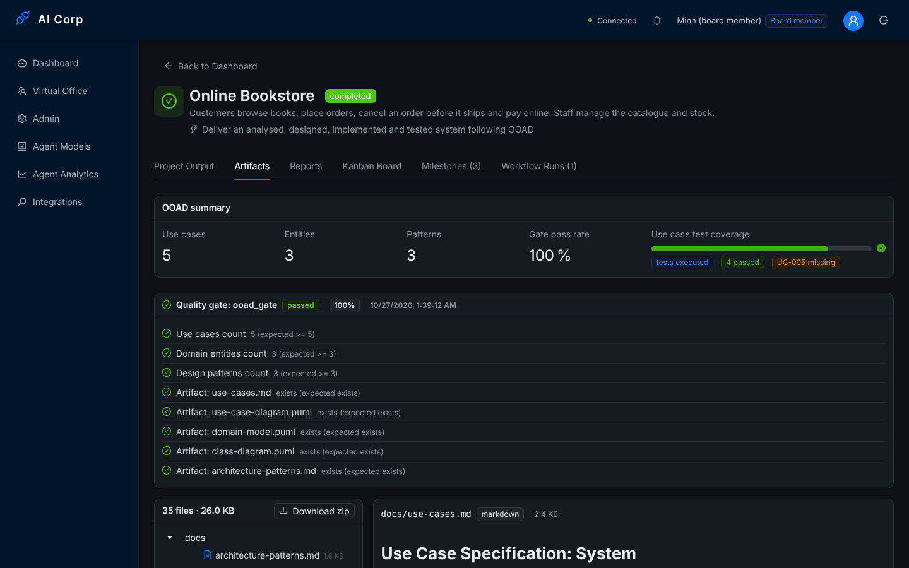

# Hiện thực

Chương này mô tả việc hiện thực thiết kế đã trình bày ở chương 4, gồm công nghệ sử dụng, quy mô mã nguồn, các đoạn mã tiêu biểu cho những mẫu thiết kế chính, giao diện người dùng và cấu hình triển khai.

## Công nghệ và quy mô

| Thành phần | Công nghệ |
|------------|-----------|
| Ngôn ngữ | TypeScript 5 (API, web, dự án sinh ra) |
| API | NestJS 10, Socket.IO, Prisma 5, BullMQ 5, pdfkit, TypeScript compiler API |
| Cơ sở dữ liệu, hàng đợi | PostgreSQL 16 (pgvector), Redis 7 |
| Web | React 18, Vite, Ant Design, TanStack Query, Zustand, Recharts |
| Kiểm thử | Jest + ts-jest (API), Vitest (web), Playwright (giao diện đầu-cuối) |
| LLM | Nhà cung cấp tương thích OpenAI (9Router, OpenAI, OpenRouter, Groq, DeepSeek, Gemini, Ollama) hoặc Anthropic, cấu hình trong ứng dụng; `NINE_ROUTER_URL` là cổng mặc định |
| Triển khai | Docker (Node 20, nginx 1.27), Docker Compose |
| Tổ chức mã | Monorepo pnpm + Turborepo: `apps/api`, `apps/web`, `packages/shared-types` |

Bảng sau cho biết quy mô mã nguồn tại thời điểm viết luận văn, được đếm tự động và không tính các tệp kiểm thử.

| Phần | Tệp | Dòng |
|------|----:|-----:|
| API (`apps/api/src`) | 342 | 28 753 |
| trong đó tầng miền (`src/domain`) | 106 | 7 226 |
| Web (`apps/web/src`) | 76 | 8 715 |
| Bộ kiểm thử API (Jest) | 50 | — |

API gồm 26 mô-đun NestJS và 295 lớp được xuất (`export class`).

## Tầng miền

Tầng miền được chia theo khái niệm thành các thư mục: `entities` (Project, Task, Milestone, Agent, v.v.), `value-objects` (Money, ProjectStatus, v.v.), `repositories` (giao diện), `events` (sự kiện miền và `EventBus`), `agent` (máy trạng thái, bộ phát sự kiện, giao diện chiến lược, học), `workflow` (đồ thị, bộ giải phụ thuộc, phiên bản ngữ nghĩa, memento), `security`, `audit`, `integration`, `reporting`, `analytics`, `estimation`, `quality`, `collaboration`.

Mỗi thực thể tự bảo vệ các bất biến của mình. Chẳng hạn, `Task.transitionTo` chỉ cho phép các chuyển trạng thái hợp lệ (todo → in_progress → review → done, và review → in_progress khi QA từ chối), còn `Money` không chấp nhận giá trị âm. Kiểm thử tầng miền từng phát hiện `Task.getCostVariance()` ném ngoại lệ với mọi công việc chưa dùng hết ngân sách, vì chênh lệch âm không biểu diễn được bằng `Money`; hàm này đã được sửa để trả về số đô-la có dấu.

```typescript
// apps/api/src/domain/repositories/IProjectRepository.ts (rút gọn)
export interface IProjectRepository {
  findById(id: string): Promise<ProjectDTO | null>;
  findAll(options?: { orderBy?: 'createdAt' | 'updatedAt'; order?: 'asc' | 'desc' }): Promise<ProjectDTO[]>;
  create(data: CreateProjectData): Promise<ProjectDTO>;
  update(id: string, data: UpdateProjectData): Promise<ProjectDTO>;
}
```

Lớp hiện thực `PrismaProjectRepository` nằm trong `src/infrastructure/persistence` và chỉ truy vấn các cột mà DTO cần. Kiểm thử tải từng phát hiện rằng truy vấn danh sách dự án tải cả ngữ cảnh JSON của lượt chạy mới nhất rồi bỏ đi không dùng; sau khi sửa, thời gian truy vấn giảm từ 46 ms xuống 9 ms.

## Tác tử

```typescript
// apps/api/src/modules/agents/base.agent.ts (rút gọn)
async execute(input: AgentContext): Promise<AgentResult<TOutput>> {
  const context = this.prepareContext(input);          // loại công việc theo RoleProfile
  const lifecycle = new AgentStateMachine(AgentState.IDLE); // một máy trạng thái mỗi lần chạy
  this.running.add(lifecycle);
  try {
    await this.publish(new TaskAssignedEvent(/* … */));
    this.transition(lifecycle, AgentState.THINKING, 'Starting thought process');
    const thought = await this.thinkingStrategy.think(context);   // Strategy
    this.transition(lifecycle, AgentState.ACTING, 'Executing action');
    const action = await this.actionStrategy.act(context, thought); // Strategy
    this.transition(lifecycle, AgentState.COMPLETED, 'Done');
    // lưu ký ức, phát AgentCompletedTaskEvent, quay về IDLE …
  } catch (error) {
    this.transition(lifecycle, AgentState.ERROR, (error as Error).message);
    // …
  } finally {
    this.running.delete(lifecycle);
  }
}
```

Mỗi vai trò có một tệp hồ sơ trong `modules/agents/profiles` và hai chiến lược trong `modules/agents/strategies`. Danh sách tác tử được NestJS tiêm vào qua token `AGENTS`; `AgentOrchestrator` dựng một bảng tra cứu theo vai trò và báo lỗi nếu có hai tác tử trùng vai trò. Như vậy, để thêm một vai trò thứ chín, chỉ cần thêm một giá trị `AgentRole`, một hồ sơ, hai chiến lược và một dòng đăng ký provider; bộ điều phối và bộ máy quy trình giữ nguyên.

Các chiến lược hành động của BA, Architect, DEV và QC ghi sản phẩm thông qua `ProjectWorkspace`. `OoadArtifactService` (mẫu Facade) dựng tài liệu và khung mã từ các mẫu Handlebars; nội dung do LLM trả về được tách thành các khối `<CODE filepath="...">`, và từng đường dẫn được kiểm tra trước khi ghi.

## Bộ máy quy trình

`WorkflowEngine` giữ một bảng ánh xạ từ loại nút (`type`) sang `NodeExecutionStrategy`. Khi có Redis, mỗi nút là một công việc BullMQ (tối đa 5 công việc chạy đồng thời); khi không có Redis, nút được thực thi trực tiếp. Khi mỗi nút kết thúc, `handleJobCompletion` ghi lại bước kèm thời lượng, chụp memento và chọn cạnh kế tiếp. Nếu nút vẫn thất bại sau các lần thử lại, kết quả được chuyển thành `failure` để lượt chạy đi theo cạnh `onFail` hoặc kết thúc ở trạng thái `failed`.

Các mẫu quy trình là lớp con của `WorkflowTemplate`, có danh sách tham số định kiểu (số, chuỗi, enum, boolean) được kiểm tra trước khi dựng định nghĩa quy trình. Ví dụ, mẫu *backend REST API* có tham số `database` kiểu enum; giá trị của tham số này được truyền vào lời nhắc thiết kế của Architect như một ràng buộc của nút, nhờ đó các Repository được thiết kế phù hợp với cơ sở dữ liệu đã chọn.

## Tính năng doanh nghiệp

- **Phân quyền:** controller được gắn `@RequirePermission(Permission.PROJECT_CREATE)`; quyền của từng vai trò được lấy từ gói `shared-types` để web và API dùng chung một định nghĩa. Giao diện ẩn các hành động mà người dùng không có quyền (ví dụ nút *New Project* đối với người xem), nhưng API vẫn kiểm tra quyền một cách độc lập.
- **Kiểm toán:** route được gắn `@Audited({ action: 'approval.approve', resourceType: 'Approval', idParam: 'id' })`; interceptor ghi kết quả *ok* hoặc *denied* kèm địa chỉ IP. Trang nhật ký có bộ lọc, phân trang và chức năng xuất CSV, trong đó các ô bắt đầu bằng `=`, `+`, `-`, `@` được thoát để chống chèn công thức.
- **Xuất báo cáo:** hỗ trợ các định dạng JSON, CSV và PDF (dùng pdfkit với phông chữ hỗ trợ tiếng Việt có dấu); báo cáo tuần được ghi vào thư mục `reports/` của dự án thay vì gửi qua email.
- **Nhà cung cấp LLM:** trên trang *LLM Providers* (chỉ dành cho quản trị viên), người dùng thêm nhà cung cấp từ các mẫu có sẵn, kiểm tra kết nối, lấy danh sách mô hình từ nhà cung cấp hoặc thêm mô hình theo mã; trên trang *Agent Models*, người dùng chọn mô hình cho từng vai trò, với danh sách mô hình được nhóm theo nhà cung cấp. Mọi thay đổi đều được ghi kiểm toán, trong đó khoá đã được che.
- **Điều khiển lượt chạy:** phần đầu trang chi tiết dự án có các nút tạm dừng, tiếp tục, huỷ, bắt đầu quy trình và điều chỉnh ngân sách; một biểu ngữ thông báo khi ngân sách đã hết hoặc khi quy trình chưa bắt đầu. Yêu cầu phê duyệt được trả lời trong một hộp thoại có phần tóm tắt dễ đọc, và người dùng bắt buộc phải nêu lý do khi từ chối.

## Giao diện người dùng

Ứng dụng web (với nhãn giao diện bằng tiếng Anh) gồm các màn hình: Bảng điều khiển (danh sách dự án có tìm kiếm, lọc, sắp xếp, tiến độ thực tế của lượt chạy và chi phí), Văn phòng ảo (trạng thái của tám tác tử theo thời gian thực và Phòng họp), Chi tiết dự án (kết quả, Sản phẩm, Báo cáo, Kanban, Mốc, Lượt chạy), Phân tích tác tử, Mô hình tác tử, Nhà cung cấp LLM, Người dùng và vai trò, Nhật ký kiểm toán, và Tích hợp. Tab *Artifacts* (Sản phẩm) hiển thị tóm tắt OOAD, kết quả cổng chất lượng, cây tệp của dự án, trình xem Markdown, mã nguồn và sơ đồ PlantUML (được render bởi máy chủ PlantUML nội bộ), cùng nút tải toàn bộ dự án dưới dạng tệp zip.

{.wide}

Trong quá trình chuẩn bị trình diễn, hai lỗi hiển thị đã được phát hiện và sửa: thẻ dự án luôn hiển thị "Starting… 0%" vì dữ liệu danh sách dự án không kèm thông tin lượt chạy, và tổng chi phí hiển thị số thực chưa được làm tròn. Đợt rà soát giao diện sau đó phát hiện thêm một lỗi nghiêm trọng hơn: trang dự án gửi yêu cầu tham gia phòng WebSocket với payload khác với định dạng mà API mong đợi, nên các sự kiện thời gian thực về công việc, quy trình và ngân sách không bao giờ đến được giao diện. Sau khi sửa, trang tham gia đúng phòng, tự tham gia lại sau khi kết nối lại và loại bỏ các sự kiện bị trùng.

## Cấu hình triển khai

- `apps/api/Dockerfile` gồm hai giai đoạn. Giai đoạn build cài đặt phụ thuộc, sinh Prisma client, build API và script seed. Giai đoạn chạy dùng `tini`, chạy dưới người dùng `node`, có phông DejaVu cho việc xuất PDF và có HEALTHCHECK gọi `/api/health/live`. Tệp `docker-entrypoint.sh` chạy `prisma migrate deploy` rồi khởi động API.
- `apps/web/Dockerfile` build ứng dụng với `VITE_API_URL=/api`, `VITE_WS_URL=/`, `VITE_PLANTUML_SERVER=/plantuml`, để mọi lời gọi đều cùng nguồn gốc (same-origin) thông qua nginx.
- `docker-compose.prod.yml` và `.env.production.example` khai báo sáu dịch vụ (trong đó một dịch vụ chỉ chạy ở hồ sơ demo), ba volume, và chỉ công bố cổng web. Các biến môi trường mới gồm `LLM_SECRET_KEY` (khoá dùng để mã hoá khoá của nhà cung cấp; nếu đổi khoá này thì phải nhập lại khoá của các nhà cung cấp), `SIGNUP_ROLE`, `ALLOW_REGISTRATION` và `JWT_EXPIRATION`.
- Để cài đặt mới từ mã nguồn, trường `packageManager` cố định phiên bản pnpm 8.15.9 (pnpm 8.0 bị lỗi trên Node 20 trở lên); cấu hình Turborepo được viết theo cú pháp của phiên bản đã cài, với gói `shared-types` được build trước; và tệp build-info của `shared-types` được đặt trong thư mục `dist` để một bản clone mới luôn build ra mã.

Quá trình chuẩn bị triển khai đã phát hiện bốn lỗi khiến cấu hình cũ không thể chạy. Thứ nhất, thư mục migration chỉ chứa lược đồ ban đầu (thiếu 8 bảng và nhiều cột, do quá trình phát triển dùng `prisma db push`). Thứ hai, tệp khoá migration nằm sai vị trí. Thứ ba, cấu hình nginx bỏ mất tiền tố `/api`, nên mọi lời gọi API đều trả về 404 và WebSocket không được chuyển tiếp. Thứ tư, Dockerfile của API gọi điểm kiểm tra sức khoẻ ở đường dẫn sai và chạy một tệp không tồn tại. Cả bốn lỗi đã được sửa và kiểm chứng (mục 6.3).
