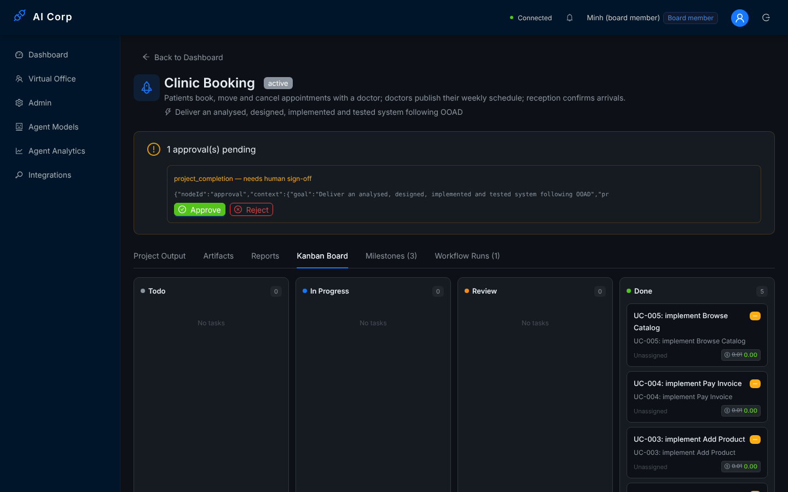

# Kiểm thử và đánh giá

Chương này trình bày cách nền tảng được kiểm chứng và các kết quả đo được. Mọi số liệu lấy từ các lần chạy có lưu vết trong kho mã; lệnh tái tạo nằm ở Phụ lục C và D.

## Chiến lược kiểm thử

Kiểm thử được tổ chức theo kim tự tháp kiểm thử [52]:

1. **Kiểm thử đơn vị** cho tầng miền (hàm thuần, không giả lập) và cho dịch vụ ứng dụng (với Repository trong bộ nhớ, LLM giả lập, sandbox giả lập).
2. **Kiểm thử tích hợp HTTP**: một ứng dụng Nest thật với các guard, interceptor và controller thật, dữ liệu trong bộ nhớ, gọi qua HTTP.
3. **Kiểm thử đầu-cuối** trên hạ tầng thật: API đã build, PostgreSQL, Redis, nginx, một LLM kịch bản tương thích OpenAI, trình duyệt Playwright cho giao diện. Mỗi lần chạy có một tệp điều khiển in một dòng cho mỗi kiểm tra và trả mã lỗi khác 0 nếu có kiểm tra thất bại.
4. **Kiểm thử tải** có ngân sách cho từng endpoint.

LLM kịch bản là lựa chọn có chủ đích: nó trả lời theo nội dung lời nhắc (ví dụ dự án tên "Legacy…" nhận mã lần đầu vi phạm phân lớp), có độ trễ tăng theo độ dài lời nhắc và một tên mô hình có giá, nên thời lượng và chi phí thay đổi giữa các dự án, đủ để huấn luyện mô hình dự báo, trong khi mọi lần chạy cho cùng kết quả.

## Kiểm thử tự động và độ bao phủ

| Bộ kiểm thử | Kết quả |
|-------------|---------|
| API (Jest) | 50 bộ, **707 đạt**, 15 bỏ qua (cần Docker daemon cho sandbox), 0 thất bại |
| Web (Vitest) | 44 đạt |
| Biên dịch | `nest build` 0 lỗi; `tsc --noEmit` của web 0 lỗi; `vite build` thành công |

Ngưỡng độ bao phủ được đặt trong cấu hình Jest, nên lệnh `npm run test:cov` thất bại nếu không đạt:

| Phạm vi | Dòng | Lệnh | Hàm | Nhánh | Ngưỡng (dòng/lệnh/hàm/nhánh) |
|---------|-----:|-----:|----:|------:|------------------------------|
| Tầng miền (`src/domain`) | **97,1%** | **96,2%** | **97,0%** | **88,1%** | 90 / 90 / 90 / 85 |
| Toàn API | 77,8% | 77,7% | 74,4% | 63,5% | sàn 70 / 70 / 64 / 55 |

Lý do đặt 90% trên tầng miền thay vì toàn bộ: tầng miền chứa các quy tắc nghiệp vụ, còn controller và phần nối NestJS chủ yếu là mã khung; ép 90% trên chúng sẽ dẫn tới kiểm thử chính framework. Toàn API vẫn có ngưỡng sàn để độ bao phủ không giảm.

## Kiểm thử đầu-cuối

Ba lần chạy đầu-cuối chính, mỗi lần trên một cơ sở dữ liệu trống:

| Lần chạy | Nội dung | Kết quả |
|----------|----------|---------|
| Triển khai và trình diễn | Cấu hình production qua nginx, dữ liệu trình diễn, phân quyền, phê duyệt, xuất PDF, phân tích, kiểm toán, nhà cung cấp LLM | **24/24** |
| Phân tích, dự báo, chất lượng mã | 8 dự án qua toàn bộ quy trình OOAD rồi 3 lượt chạy khi mô hình của Marketing ngừng hoạt động; bộ nhận webhook thật | **21/21** |
| Bảo mật, kiểm toán, tích hợp | Vai trò và quyền, nhật ký kiểm toán, khoá API, giới hạn tần suất, webhook ký HMAC, xuất dữ liệu, báo cáo | **44/44** |

Ngoài ra có các lần chạy cho bộ máy quy trình (quy trình con, ghim phiên bản, ảnh chụp và khôi phục, nhánh song song) và cho hệ thống tác tử (sản phẩm OOAD được lưu, kiểm thử của QC được thực thi, học, lập trình cặp).

Lần chạy triển khai kiểm tra những điều mà kiểm thử đơn vị không thấy được:

- `prisma migrate deploy` dựng đúng lược đồ trên cơ sở dữ liệu trống (ba migration, gồm migration của bảng nhà cung cấp LLM), và lược đồ sau đó **không lệch** so với mô hình (`prisma migrate diff --exit-code` trả 0).
- API ở chế độ production từ chối khởi động với cấu hình sai: thiếu `JWT_SECRET` và `CORS_ORIGIN`, khoá LLM là `CHANGE_ME` → thoát với mã 1 và thông báo nêu đủ ba lỗi.
- Qua nginx: kiểm tra sức khoẻ báo cơ sở dữ liệu, Redis và cổng LLM đều *healthy*; khi dừng PostgreSQL, `/api/health` trả **503** còn `/api/health/live` vẫn 200; khởi động lại thì trở về 200.
- Swagger tắt khi `ENABLE_SWAGGER=false`; CORS chỉ trả header cho nguồn gốc được cấu hình.
- WebSocket qua nginx chấp nhận token đăng nhập và ngắt kết nối token giả.
- Người xem không tạo được dự án, không duyệt được qua REST **và không duyệt được qua WebSocket** (lỗ hổng được phát hiện và sửa trong lần chạy này, mục 6.9).
- Một phê duyệt chỉ được trả lời một lần: câu trả lời thứ hai nhận 409. Tài khoản tự đăng ký nhận vai trò người xem. Cổng LLM trong cấu hình được nhập thành nhà cung cấp đầu tiên (19 mô hình) và API không trả khoá của nó.
- Sau khi thành viên hội đồng duyệt, CEO đóng dự án; nhật ký kiểm toán có `auth.login`, `project.create`, `approval.requested`, `approval.approve`, `access.denied`, `quality.gate.evaluated`, `workflow.completed`.

{.wide}

## Thời gian xử lý của một nút quy trình

Yêu cầu phi chức năng đặt ra là mỗi nút quy trình xử lý trong 2 giây, không tính độ trễ của LLM (độ trễ này phụ thuộc nhà cung cấp và nằm ngoài tầm kiểm soát của nền tảng). Thời lượng của 43 bước tác tử trong lần chạy triển khai (LLM kịch bản trả lời sau 20 ms cộng 1 ms cho mỗi 25 ký tự lời nhắc, nên con số dưới đây vẫn bao gồm một phần độ trễ giả lập):

| Vai trò | Số bước | p50 (ms) | p95 (ms) | Lớn nhất (ms) |
|---------|--------:|---------:|---------:|--------------:|
| CEO | 10 | 75 | 100 | 100 |
| BA | 5 | 107 | 121 | 121 |
| Architect | 5 | 582 | 607 | 607 |
| PM | 4 | 105 | 110 | 110 |
| DEV | 5 | 614 | 632 | 632 |
| QC | 5 | 1 642 | 1 726 | 1 726 |
| QA | 5 | 259 | 279 | 279 |
| Marketing | 4 | 75 | 81 | 81 |
| **Tất cả** | **43** | **110** | **1 642** | p99: **1 726** |

Mọi nút đều dưới 2 giây; kết quả gần như trùng với lần đo trước khi bộ máy được thêm bước kiểm tra ngân sách trước mỗi nút (p50 108 ms, p95 1 687 ms), nên bước kiểm tra này không làm chậm đáng kể. Nút chậm nhất là QC vì nó thực sự chạy bộ kiểm thử Jest của dự án sinh ra; Architect và DEV chậm hơn các vai trò khác vì ghi nhiều tệp và chạy phân tích tĩnh.

## Hiệu năng dưới tải

Kiểm thử tải dùng một script không phụ thuộc thư viện, mô phỏng người dùng bảng điều khiển (xem danh sách và chi tiết dự án, công việc, báo cáo chi phí, phân tích tác tử, dự báo, chất lượng mã), có ngân sách p50/p95/p99 cho từng endpoint (100/500/1000 ms mặc định, 300/1500/3000 ms cho phân tích, dự báo và chất lượng mã, 500/2000/3000 ms cho tạo dự án) và tỉ lệ lỗi tối đa 1%. Môi trường: một tiến trình API ở chế độ production, PostgreSQL và Redis trên một máy 4 lõi dùng chung với bộ sinh tải và LLM kịch bản; cơ sở dữ liệu bắt đầu từ dữ liệu trình diễn (5 dự án) và lớn dần khi các kịch bản tạo dự án.

| Kịch bản | Yêu cầu/giây | Lỗi | Kết quả theo ngân sách |
|----------|-------------:|----:|------------------------|
| 1 người dùng | 184,7 | 0% | Mọi endpoint trong ngân sách; p50 từ 3 đến 7 ms |
| 20 người dùng, chỉ đọc | **604,8** | 0% | Mọi endpoint trong ngân sách; p95 cao nhất 84 ms |
| 20 người dùng, đồng thời tạo 111 dự án | 430,7 | 0% | Mọi endpoint trong ngân sách; tạo dự án p50 107 ms, p99 177 ms |
| 50 người dùng, tạo 48 dự án | 407,2 | 0% | Bão hoà: p50 77–312 ms, năm endpoint vượt ngân sách p50 100 ms; mọi p99 dưới 0,7 s |

Ở 50 người dùng, một tiến trình đã bão hoà ở khoảng 407 yêu cầu/giây, nên theo định luật Little [41] mỗi yêu cầu chờ khoảng 50 / 407 ≈ 123 ms; đây là giới hạn của một tiến trình chứ không phải của truy vấn. API không giữ trạng thái (lượt chạy được điều phối qua BullMQ và PostgreSQL), nên mở rộng là chạy thêm tiến trình.

Lần đo trước, trên một cơ sở dữ liệu khoảng 120 dự án, cho 201,8 yêu cầu/giây với 20 người dùng và bão hoà ở 178 yêu cầu/giây. Hai lần đo không so sánh trực tiếp được vì cỡ dữ liệu khác nhau, nên luận văn không coi chênh lệch là mức cải thiện. Điều so sánh được là kết quả theo ngân sách: ở cả hai lần, mọi endpoint với 20 người dùng nằm trong hoặc sát ngân sách và không có lỗi. Lần đo trước tìm ra ba lỗi hiệu năng (mục 6.9); sau khi sửa, endpoint chất lượng mã giảm p50 từ 3,1 s xuống 196 ms trong cùng kịch bản.

## Độ chính xác của dự báo

Sau 8 dự án hoàn tất, mọi vai trò đủ mẫu để dùng hồi quy. Sai số leave-one-out của thời gian tác tử:

| Vai trò | MAPE (LOO) |
|---------|-----------:|
| Architect | 3% |
| CEO | 5% |
| BA | 11% |
| DEV | 30% |

Dự báo lúc bắt đầu của 7 dự án (dự án đầu tiên chưa có lịch sử) có sai số tuyệt đối trung bình 21% về thời gian và 20% về chi phí. Phần lớn sai số đến từ một dự án mà QA từ chối mã và DEV phải làm lại (chi phí vượt dự báo 84%); các dự án còn lại sai lệch 0–10%. Điều này là đúng bản chất: việc làm lại do bị từ chối không thể biết trước lúc bắt đầu, nên nền tảng lưu cả dự báo lúc bắt đầu và lúc PM lập kế hoạch, và luôn hiển thị dự báo cạnh kết quả thực tế.

## Dự đoán chất lượng mã

| Trường hợp | Diễn biến |
|------------|-----------|
| *Legacy Billing* | Mã lần đầu của DEV nhập tầng hạ tầng từ miền, chứa khoá viết cứng, gọi `eval` và dồn quy tắc vào một phương thức dài. Điểm 77, có vi phạm phân lớp → dự đoán *fail* → DEV sửa một vòng → điểm 100, bản sửa được giữ, QA duyệt |
| *Unsafe Portal* | Vòng sửa không cải thiện điểm nên bản gốc được giữ; QA thấy `eval` và báo cáo phân tích, trả lời FAIL; quy trình quay lại DEV, lần hai đạt |
| Toàn bộ | 9 lần rà soát QA: 8 lần dự đoán *pass* và được duyệt, 1 lần dự đoán *fail* và bị từ chối |

Độ chính xác 100% trên 9 lần rà soát cần được hiểu đúng: với LLM kịch bản, các lỗi được cài sẵn đúng loại mà bộ phân tích phát hiện được. Con số này chứng minh chuỗi dự đoán → sửa → đối chiếu hoạt động, không phải chứng minh độ chính xác với LLM thật (mục 7.4).

## Nghiên cứu tình huống

Năm dự án trình diễn được dựng qua API công khai như người dùng thật, mỗi dự án minh hoạ một khía cạnh:

| Dự án | Mẫu quy trình | Kết quả |
|-------|---------------|---------|
| Online Bookstore | Dự án phần mềm OOAD | 5 use case, 3 thực thể, 3 mẫu thiết kế, cổng OOAD 100%; 35 tệp; 4 kiểm thử chấp nhận chạy đạt; độ bao phủ use case 80%, UC-005 được báo thiếu kiểm thử; marketing; hoàn tất |
| Legacy Billing | Dự án phần mềm OOAD | Phân tích tĩnh phát hiện vi phạm, DEV tự sửa (77 → 100) trước QA; hoàn tất |
| Unsafe Portal | Dự án phần mềm OOAD | QA từ chối, quy trình quay lại DEV (2 bước DEV, 2 lần rà soát QA); hoàn tất |
| Library Loans | Chỉ phân tích và thiết kế | Use case, mô hình miền, sơ đồ qua cổng OOAD; hoàn tất |
| Clinic Booking | Dự án phần mềm OOAD, có phê duyệt | Dừng ở bước phê duyệt; người xem không duyệt được; thành viên hội đồng duyệt, CEO đóng dự án |

Cả năm dự án được tạo và chạy xong trong khoảng 25 giây với LLM kịch bản.

## Lỗi phát hiện nhờ kiểm thử và rà soát

Một kết quả quan trọng của việc kiểm thử trên hạ tầng thật là các lỗi được tìm ra và sửa. Ngoài kiểm thử tự động, hai nguồn khác đã tìm ra lỗi: một đợt **rà soát mã có hệ thống phần giao diện và logic**, đọc từng màn hình và đối chiếu với API mà nó gọi, và việc **cài đặt mới từ mã nguồn** trên một máy khác. Bảng sau tóm tắt theo nhóm (danh sách đầy đủ kèm cách sửa nằm trong kế hoạch dự án và lịch sử thay đổi của kho mã).

| Nhóm | Ví dụ tiêu biểu | Kiểm thử | Rà soát | Cài đặt mới | Tổng |
|---------------|-------------------------------------------------------------|--------:|--------:|--------:|------:|
| Không khởi động / không chạy được | API không khởi động vì hai chiến lược có tham số hàm tạo mà DI không giải được; migration thiếu 8 bảng; nginx bỏ tiền tố `/api`; pnpm 8.0 lỗi trên Node 20; một bản clone mới không build ra `shared-types`; script dữ liệu trình diễn hỏng khi đăng ký mặc định thành người xem | 6 | 0 | 4 | 10 |
| Bảo mật | Duyệt qua WebSocket bỏ qua quyền và kiểm toán; ba giá trị dự phòng khác nhau cho khoá JWT; tự đăng ký nhận quyền thành viên hội đồng; một phê duyệt trả lời được hai lần; sửa công việc không kiểm tra chủ dự án | 3 | 3 | 0 | 6 |
| Thiết kế OOAD không được dùng | 4/8 tác tử vẫn chạy luồng cũ nên chiến lược là mã chết; cổng chất lượng không được đăng ký; sản phẩm của tác tử mất sau mỗi lệnh sandbox; quy trình lập kế hoạch trước khi có yêu cầu | 6 | 0 | 0 | 6 |
| Tính đúng của quy trình và trạng thái | Một máy trạng thái cho mỗi vai trò; nút thất bại để lượt chạy `running` mãi; *Pause* chỉ đổi trạng thái dự án; *Resume* ở bước phê duyệt tạo phê duyệt trùng; dự án đã huỷ bị đánh dấu hoàn tất; lý do từ chối không đến được tác tử | 8 | 6 | 0 | 14 |
| Chi phí và sự kiện | Chi phí LLM của 4 vai trò không được ghi; nút vẫn bắt đầu khi ngân sách đã hết; cộng chi phí kiểu đọc rồi ghi bị mất cập nhật khi đồng thời; không có sự kiện `approval.requested` và `workflow.failed` | 4 | 3 | 0 | 7 |
| Hiệu năng | Phân tích lại mọi tệp ở mỗi yêu cầu (3,1 s); danh sách dự án tải JSON không dùng; bốn truy vấn tuần tự | 3 | 0 | 0 | 3 |
| Tài liệu và giao diện | 12/39 sơ đồ UML không render được; thẻ dự án luôn "0%"; trang dự án tham gia phòng WebSocket sai payload nên không nhận sự kiện thời gian thực | 3 | 1 | 0 | 4 |
| **Tổng** | | **33** | **13** | **4** | **50** |

Mười ba lỗi do rà soát tìm ra đều nằm ở những đường mà kiểm thử tự động không đi qua: các kiểm thử đầu-cuối chạy quy trình từ đầu đến cuối, nhưng không tạm dừng rồi tiếp tục, không trả lời một phê duyệt hai lần, không chạy hai lần cộng chi phí cùng lúc. Sau khi sửa, mỗi lỗi có một kiểm thử đơn vị riêng (`run-control.spec.ts`, `approval-and-signup.spec.ts`), và ba hành vi được thêm vào lần chạy đầu-cuối triển khai (phê duyệt trả lời một lần, đăng ký nhận quyền xem, khoá nhà cung cấp không bị trả về). Chính lần chạy lại đó phát hiện script dữ liệu trình diễn còn giả định tài khoản tự đăng ký là thành viên hội đồng.

Lỗ hổng phê duyệt qua WebSocket đáng chú ý vì mọi kiểm thử trước đó đều đi qua REST. Nó chỉ lộ ra khi kiểm thử đi theo đúng đường mà giao diện dùng: người xem nhận 403 từ `POST /api/approvals/:id/approve`, nhưng gửi thông điệp `human:approval_response` qua WebSocket thì phê duyệt được chấp nhận, dự án được đóng, và không có mục kiểm toán nào. Bài học thiết kế là mọi đường ghi phải đi qua cùng một điểm kiểm soát; đường WebSocket nay từ chối thông điệp này, giao diện dùng REST, và lần chạy đầu-cuối có kiểm tra riêng cho trường hợp này.
