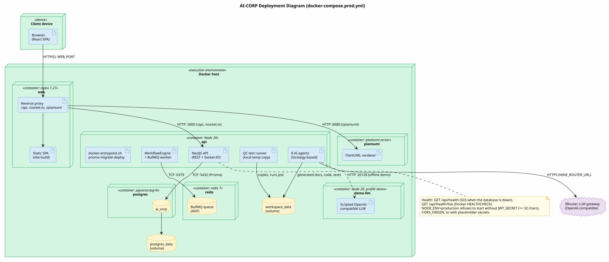

# Phụ lục A. Danh mục sơ đồ UML {.appendix}

Các sơ đồ là mã nguồn PlantUML trong `docs/diagrams/`. Lệnh `scripts/docs/render-diagrams.sh` tải PlantUML (kiểm tra mã băm SHA-1), render toàn bộ sang SVG trong `docs/diagrams/rendered/` và dừng với mã lỗi khác 0 ở sơ đồ đầu tiên có lỗi cú pháp. Danh mục đầy đủ có liên kết nằm ở `docs/diagrams/INDEX.md`.

| Góc nhìn | Số sơ đồ | Sơ đồ |
|----------|---------:|-------|
| Use case | 4 | Toàn hệ thống; quản trị viên; thành viên hội đồng; tác tử |
| Lớp | 13 | Tổng quan mô hình miền; aggregate Agent, Project, Workflow; Strategy, Observer, Repository, Factory; vòng học; cộng tác tác tử; bộ máy quy trình; bảo mật, kiểm toán, tích hợp, báo cáo; phân tích, dự báo, chất lượng mã |
| Tuần tự | 11 | SD-001 tạo dự án; SD-002 chu trình suy nghĩ–hành động; SD-003 phê duyệt; SD-004 chuỗi giao việc; SD-005 học; SD-006 ảnh chụp và khôi phục; SD-007 lập trình cặp; SD-008 quy trình con; SD-009 gọi API bằng khoá API; SD-010 gửi webhook; SD-011 xuất dự án |
| Hoạt động | 4 | AD-001 vòng đời dự án; AD-002 quy trình có nhánh song song; AD-003 ước lượng công sức và chi phí; AD-004 phân tích và sửa chất lượng mã |
| Máy trạng thái | 4 | SM-001 tác tử; SM-002 lượt chạy quy trình; SM-003 công việc; SM-004 phê duyệt |
| Kiến trúc | 3 | Gói; thành phần; triển khai |
| **Tổng** | **39** | |

{.wide}

{.wide}

# Phụ lục B. Giao diện lập trình (API) {.appendix}

Mọi đường dẫn có tiền tố `/api`. Trừ `auth/register`, `auth/login` và `health`, mọi route yêu cầu JWT (giao diện web) hoặc khoá API (nhóm `/v1`), và được kiểm quyền theo vai trò. Khi `ENABLE_SWAGGER=true`, tài liệu OpenAPI đầy đủ có tại `/api/docs`.

| Nhóm | Route |
|------|-------|
| Xác thực | `POST auth/register`, `POST auth/login`, `GET auth/me` |
| Dự án | `GET/POST projects`, `GET/PATCH/DELETE projects/:id` |
| Công việc, mốc | `GET tasks`, `POST projects/:projectId/tasks`, `PATCH tasks/:id`; `GET/POST projects/:projectId/milestones`, `PATCH milestones/:id` |
| Sản phẩm của dự án | `GET projects/:id/files`, `GET projects/:id/files/*`, `GET projects/:id/archive` (zip), `GET projects/:id/quality-gates` |
| Phê duyệt | `GET approvals`, `POST approvals/:id/approve`, `POST approvals/:id/reject` |
| Quy trình | `GET workflows/templates`, `POST workflows/templates/:templateId/preview`, `GET workflows/definitions[/:definitionId]`, `GET workflows/runs/:runId`, `GET workflows/runs/:runId/snapshots`, `POST workflows/runs/:runId/rollback`, `POST workflows/runs/:runId/pause`, `POST workflows/runs/:runId/resume` |
| Mô hình LLM | `GET models`, `GET models/available`, `PATCH models/:role` |
| Chi phí, báo cáo, xuất | `GET cost/summary`, `GET reports/projects/:id/cost`, `GET reports/performance`, `POST reports/weekly/run`, `GET projects/:id/export?format=json|csv|pdf` |
| Phân tích, dự báo, chất lượng | `GET analytics/agents`, `GET agents/:role/learning`, `GET projects/:id/estimate`, `GET analytics/estimation`, `GET projects/:id/code-quality`, `GET ooad-metrics/dashboard`, `GET ooad-metrics/project/:id`, `GET ooad-metrics/leaderboard` |
| Người dùng, kiểm toán | `GET users`, `GET users/roles`, `PATCH users/:id/role`, `PATCH users/:id/active`; `GET audit`, `GET audit/export`, `GET audit/anomalies` |
| Tích hợp (quản trị) | `GET integrations/events`, `GET/POST integrations/api-keys`, `DELETE integrations/api-keys/:id`, `GET/POST integrations/webhooks`, `DELETE integrations/webhooks/:id`, `POST integrations/webhooks/:id/test`, `GET integrations/webhooks/:id/deliveries` |
| API công khai (khoá API) | `GET/POST v1/projects`, `GET v1/projects/:id/status`, `GET v1/projects/:id/reports/cost`, `GET v1/projects/:id/export`, `GET/POST v1/webhooks`, `DELETE v1/webhooks/:id` |
| Sức khoẻ | `GET health` (503 khi cơ sở dữ liệu ngừng), `GET health/live` |

**WebSocket** (Socket.IO, xác thực bằng JWT khi kết nối): máy khách gửi `subscribe_project` để nhận `project_event` của một dự án; máy chủ phát thêm `system_event` (trạng thái tác tử) và `user_event`. Thông điệp `human:approval_response` bị từ chối; phê duyệt chỉ đi qua REST (mục 6.9).

# Phụ lục C. Số liệu và cách tái tạo kiểm thử {.appendix}

## Kiểm thử tự động

```bash
pnpm install
cd apps/api && npx jest                    # 47 bộ, 674 đạt, 15 bỏ qua
cd apps/api && npm run test:cov            # độ bao phủ, thất bại nếu dưới ngưỡng
cd apps/web && npx vitest run && npx tsc --noEmit
```

## Kiểm thử đầu-cuối

Mỗi lần chạy có script, kết quả và ảnh chụp trong một thư mục `docs/*-e2e/` của kho mã, kèm README ghi môi trường và lệnh chạy. Script in một dòng cho mỗi kiểm tra và trả mã 1 khi có kiểm tra thất bại.

| Lần chạy | Script | Kiểm tra |
|----------|--------|---------:|
| Triển khai và trình diễn | `docs/phase7-e2e/e2e.mjs` sau `scripts/demo/seed-demo.mjs` | 21 |
| Phân tích, dự báo, chất lượng mã | `docs/phase6-e2e/e2e.mjs` | 21 |
| Bảo mật, kiểm toán, tích hợp | `docs/phase5-e2e/e2e.mjs` | 44 |
| Bộ máy quy trình (quy trình con, ghim phiên bản, ảnh chụp, khôi phục) | `docs/phase4-e2e/e2e.mjs` | theo kịch bản |

Môi trường chung: PostgreSQL 16 có pgvector, Redis 7, API build ở chế độ production, LLM kịch bản `scripts/demo/demo-llm.cjs` (tương thích OpenAI, cổng 20128). Lần chạy triển khai đi qua nginx với cấu hình giống `apps/web/nginx.conf`.

## LLM kịch bản

Máy chủ trả lời theo vai trò và nội dung lời nhắc. Các quy tắc có ảnh hưởng đến kết quả đánh giá:

| Điều kiện | Câu trả lời |
|-----------|-------------|
| Tên dự án bắt đầu bằng "Legacy" | Mã lần đầu của DEV nhập hạ tầng từ miền, có khoá viết cứng, `eval` và phương thức dài; lần sửa thì sạch |
| Tên dự án bắt đầu bằng "Unsafe" | Mã có `eval`; QA trả lời FAIL ở lần rà soát đầu, PASS ở lần hai |
| Mô hình của Marketing bị đánh dấu ngừng hoạt động | Lỗi 503, dùng để kiểm tra phát hiện bất thường |
| Mọi lời gọi | Độ trễ 20 ms + 1 ms cho mỗi 25 ký tự lời nhắc; số token theo độ dài; giá theo tên mô hình |

## Dữ liệu trình diễn

`scripts/demo/seed-demo.mjs` tạo hai tài khoản (thành viên hội đồng, người xem) và năm dự án ở mục 6.8. Script lặp lại được: chạy lần hai không tạo bản trùng.

# Phụ lục D. Số liệu hiệu năng {.appendix}

## Kiểm thử tải

Script `scripts/perf/load-test.mjs` (không phụ thuộc thư viện), ngân sách trong `scripts/perf/budgets.json`:

```bash
node scripts/perf/load-test.mjs --api http://localhost:3000/api --users 20 --duration 30 --create-every 0
node scripts/perf/load-test.mjs --users 20 --duration 30 --create-every 10   # có quy trình đang chạy
node scripts/perf/load-test.mjs --users 50 --duration 30 --create-every 25   # bão hoà
```

Kết quả chi tiết với 20 người dùng chỉ đọc (30 s, 6 078 yêu cầu, 201,8 yêu cầu/giây, 0% lỗi):

| Endpoint | Số yêu cầu | p50 (ms) | p95 (ms) | p99 (ms) | Ngân sách p50/p95/p99 |
|----------|-----------:|---------:|---------:|---------:|-----------------------|
| `GET /analytics/agents` | 578 | 128 | 199 | 229 | 300/1500/3000 |
| `GET /health` | 300 | 81 | 154 | 187 | 100/500/1000 |
| `GET /projects` | 1 505 | 79 | 148 | 182 | 100/500/1000 |
| `GET /projects/:id` | 1 242 | 86 | 150 | 187 | 100/500/1000 |
| `GET /projects/:id/code-quality` | 615 | 58 | 404 | 556 | 300/1500/3000 |
| `GET /projects/:id/estimate` | 623 | 130 | 219 | 257 | 300/1500/3000 |
| `GET /reports/projects/:id/cost` | 628 | 102 | 177 | 222 | 100/500/1000 |
| `GET /tasks?projectId` | 587 | 76 | 136 | 178 | 100/500/1000 |

Ba lỗi hiệu năng tìm được nhờ kiểm thử tải và hiệu quả của bản sửa (cùng kịch bản 50 người dùng có tạo dự án):

| Lỗi | Cách sửa | Kết quả |
|-----|----------|---------|
| Endpoint chất lượng mã phân tích lại mọi tệp ở mỗi yêu cầu | Lưu kết quả theo mã băm nội dung tệp và theo dự án trong 30 s; DEV xoá bộ đệm khi ghi lại mã; đọc tệp song song | p50 3 116 → 196 ms |
| Danh sách dự án tải JSON ngữ cảnh của lượt chạy rồi bỏ đi | Repository chỉ chọn các cột DTO cần | 46 → 9 ms (1 người dùng) |
| Chi tiết dự án chạy bốn truy vấn độc lập tuần tự | Chạy song song | 16 → 9 ms (1 người dùng) |

Thông lượng ở kịch bản bão hoà tăng từ 98,8 lên 178,3 yêu cầu/giây.

## Thời gian theo bước tác tử

Bảng theo vai trò nằm ở mục 6.4. Dữ liệu gốc là trường `durationMs` của các bước trong lượt chạy, đọc qua `GET /api/workflows/runs/:runId`; các lượt chạy của lần kiểm thử triển khai được lưu trong `docs/phase7-e2e/out/`.

# Phụ lục E. Hướng dẫn sử dụng {.appendix}

## Cài đặt bằng Docker

```bash
cp .env.production.example .env.production
# Điền POSTGRES_PASSWORD, JWT_SECRET (openssl rand -hex 32, tối thiểu 32 ký tự),
# CORS_ORIGIN (địa chỉ web), NINE_ROUTER_URL và NINE_ROUTER_API_KEY (cổng LLM),
# SEED_ADMIN_EMAIL và SEED_ADMIN_PASSWORD (tối thiểu 12 ký tự)
docker compose -f docker-compose.prod.yml --env-file .env.production up -d --build
```

Giao diện web ở `http://localhost:8080` (đổi bằng `WEB_PORT`). Lần khởi động đầu chạy migration và tạo tài khoản quản trị; sau đó đặt `SEED_ON_START=false`. API từ chối khởi động nếu còn giá trị mẫu (`CHANGE_ME`), thiếu `JWT_SECRET` hoặc `CORS_ORIGIN`, hoặc khoá JWT ngắn hơn 32 ký tự, và in đủ danh sách lỗi. Thêm `--profile demo` để chạy kèm LLM kịch bản phục vụ trình diễn.

## Vai trò người dùng

| Vai trò | Có thể |
|---------|--------|
| Quản trị viên (`admin`) | Mọi thao tác, gồm quản lý người dùng và vai trò, khoá API, webhook, cấu hình mô hình LLM |
| Thành viên hội đồng (`board_member`) | Tạo và quản lý dự án của mình, duyệt hoặc từ chối phê duyệt, xem báo cáo và phân tích |
| Người xem (`viewer`) | Chỉ xem; giao diện ẩn các nút tạo, sửa, duyệt và API trả 403 nếu gọi trực tiếp |

## Các thao tác chính

Giao diện dùng nhãn tiếng Anh; tên màn hình được ghi nguyên văn trong ngoặc.

1. **Tạo dự án:** *Dashboard* → *New Project*, nhập tên, mô tả yêu cầu, ngân sách, chọn mẫu quy trình (ví dụ dự án phần mềm OOAD hoặc chỉ phân tích và thiết kế) và tham số của mẫu. Quy trình bắt đầu ngay.
2. **Theo dõi:** *Virtual Office* cho thấy trạng thái tám tác tử theo thời gian thực, và *Meeting Room* hiển thị trao đổi giữa các tác tử. Trang chi tiết dự án có tab *Workflow Runs* với dòng thời gian, ảnh chụp và nút khôi phục.
3. **Phê duyệt:** khi quy trình đến nút phê duyệt, thông báo xuất hiện cho thành viên hội đồng; duyệt hoặc từ chối kèm ghi chú trên trang chi tiết dự án.
4. **Xem sản phẩm:** tab *Artifacts* có tóm tắt OOAD, kết quả cổng chất lượng, cây tệp, trình xem Markdown, mã và sơ đồ, và nút tải zip.
5. **Báo cáo và dự báo:** tab *Reports* có chi phí theo vai trò, dự báo thời gian và chi phí, điểm chất lượng mã; xuất JSON, CSV hoặc PDF.
6. **Phân tích tác tử:** *Agent Analytics* so sánh hiệu năng các vai trò và cảnh báo bất thường; *Agent Models* chọn mô hình LLM cho từng vai trò.
7. **Quản trị:** *Users & Roles* (vai trò, kích hoạt), *Audit Log* (lọc, xuất CSV, bất thường), *Integrations* (khoá API, webhook, lịch sử gửi).
